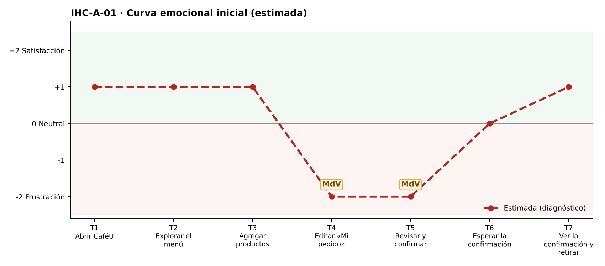

# Fase 1 · Diagnóstico emocional — IHC-A-01 · CaféU · Total que se actualiza en un pedido rápido

**Responsable de la tarjeta:** Acaro Ibujés Pedro Sebastián · **Revisor:** Vinces Cueva Boris Yussef · **Issue:** #1

## 1. Tarjeta
| Campo | Contenido |
|---|---|
| Persona usuaria | Estudiante de primer nivel que compra entre clases |
| Tarea crítica | Agregar café y sánduche; confirmar un pedido |
| Restricción obligatoria | Solo dispone de 3 minutos y utiliza pantalla de 360 px |
| Fallo adicional específico | El total no cambia al variar cantidades |
| Repositorio base | Sax300-cpu/HCI-2026-G2 (CaféU: requisitos, sitemap, user flow confirmar/editar, cinco wireframes; carpeta presentacion) |
| Repositorio complementario | maribelsailema/HCI_2026_G1 (Dashboard UX) |

## 2. Touchpoints
Siete touchpoints del recorrido de la tarea crítica sobre la interfaz de referencia. En esta fase las emociones son **estimadas**; las observadas están en `pruebas/sesion.md`.

| N.º | Touchpoint | Qué ocurre | Emoción estimada | Tipo | Momento de verdad |
|---|---|---|---|---|---|
| T1 | Abrir CaféU | Llega con 3 min de receso; ve horario y botón «Ver menú». | +1 | Estimado | — |
| T2 | Explorar el menú | Recorre 5 productos en 360 px. | +1 | Estimado | — |
| T3 | Agregar productos | Pulsa «Agregar» en café y sánduche; ve aviso y contador. | +1 | Estimado | — |
| T4 | Editar «Mi pedido» | Sube a 2 cafés con «+». | −2 😟 | Estimado | **Sí** |
| T5 | Revisar y confirmar | Revisa el resumen y el botón «Confirmar · $X». | −2 😟 | Estimado | **Sí** |
| T6 | Esperar la confirmación | Ve «Enviando…» con el botón bloqueado. | 0 😐 | Estimado | — |
| T7 | Ver la confirmación y retirar | Lee N.º de pedido y total a pagar. | +1 | Estimado | — |

## 3. Momentos de verdad
1. **T4 · Editar «Mi pedido».** «Editar Mi pedido»: al cambiar la cantidad el total sigue en $4,25; el estudiante ya no sabe cuánto pagará.
2. **T5 · Revisar y confirmar.** «Revisar y confirmar»: confirma un importe que no corresponde a lo que pidió, con el tiempo encima.

## 4. Curva emocional inicial

## 5. Fallos priorizados
Prioridad = severidad de Nielsen × frecuencia esperada.

| N.º | Fallo | Heurística de Nielsen | Gestalt / carga cognitiva | Severidad | Frecuencia | Prioridad | Decisión | Seguimiento |
|---|---|---|---|---|---|---|---|---|
| 1 | El total no cambia al variar cantidades | N1 Visibilidad del estado del sistema; N5 Prevención de errores | Carga cognitiva: obliga a calcular mentalmente con prisa | 4 · Catastrófico | Alta | P1 | Recalcular subtotal y total en cada cambio (v2). | Issue #1 |
| 2 | En 360 px el total y la acción principal quedan fuera de la vista | N8 Diseño minimalista; N6 Reconocer antes que recordar | Gestalt: región común — total y botón separados del resumen | 3 · Grave | Media | P2 | Mostrar el total dentro del botón principal fijo («Revisar pedido · $X»). | Tarea de la issue #1 |
| 3 | No hay indicador de avance para quien tiene solo 3 minutos | N1 Visibilidad del estado | Carga cognitiva: no sabe cuántos pasos faltan | 2 · Menor | Media | P3 | Indicador «Paso n de 3» tomado del Stepper del Dashboard UX. | Tarea de la issue #1 |

## 6. Estimación frente a observación
| Afirmación | Tipo | Cómo se comprueba |
|---|---|---|
| «El total no cambia al variar cantidades» afecta la tarea crítica. | Estimación | Prueba cognitiva con v1 (tiempo, errores, pausas, cita). |
| Los momentos de verdad son T4 y T5. | Estimación | Pausas y comentarios de la prueba. |
| La curva mejora tras la corrección. | Estimación | Misma tarea con v2 (`curva-despues.png`). |

## 7. Principio del repositorio complementario
Stepper y visibilidad del estado del Dashboard UX: «Paso n de 3» en la cabecera.
