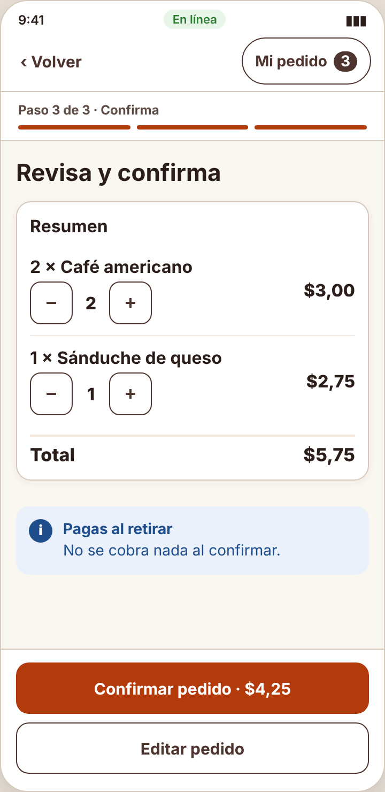
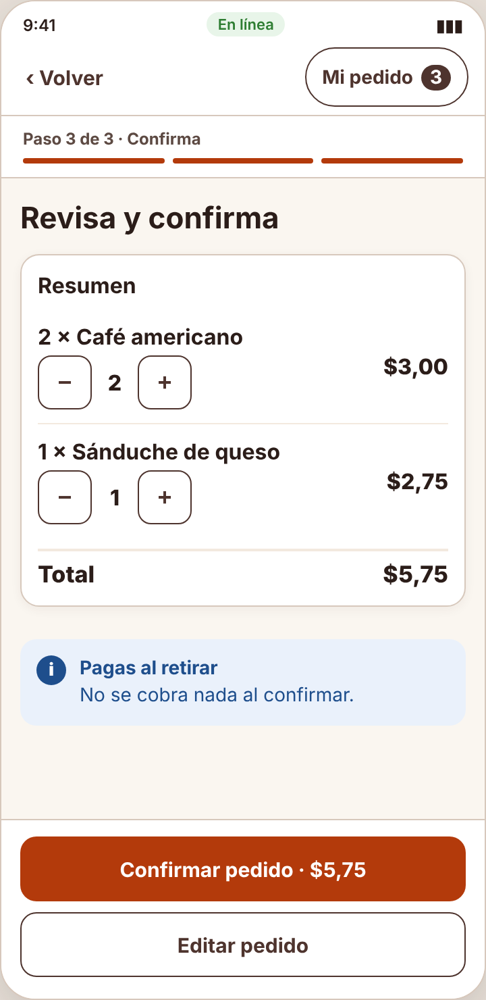

# Incidencia — IHC-A-01 · CaféU · Total que se actualiza en un pedido rápido

| Campo | Detalle |
|---|---|
| Incidencia (minuto 100) | Recalcular el total y anunciar cada cambio; impedir confirmar un importe obsoleto |
| Responsable / revisor | Acaro Ibujés Pedro Sebastián / Vinces Cueva Boris Yussef |
| Requisito nuevo | **RF-07** — Anunciar cada cambio de total (aria-live) e impedir confirmar si el importe del botón no coincide con el total actual. |
| Criterio | Al editar en «Revisa y confirma» el botón y el total cambian a la vez; si difieren, se bloquea y se pide revisar. |
| Flujo | `diagramas/user-flow.png` (nodos en naranja) |
| Cambio en el prototipo | En `renderReview()` el botón «Confirmar · $X» se actualiza en cada edición y `live()` anuncia «Total actualizado»; en el clic de confirmar se compara el importe mostrado con `total()` y, si difieren, se bloquea con «El total cambió». |
| Prueba | Editó la cantidad en «Revisa y confirma»: el botón cambió a $7,25 al mismo tiempo — 79 s, 0 errores. Cita: «El botón dice lo mismo que el total.» |
| Commit | Rama `fix/pedro-incidencias-01-03`, posterior a la entrega, con «Closes #» de la issue de la incidencia |

| Antes (v2) | Después (v2 con incidencia) |
|---|---|
|  |  |
