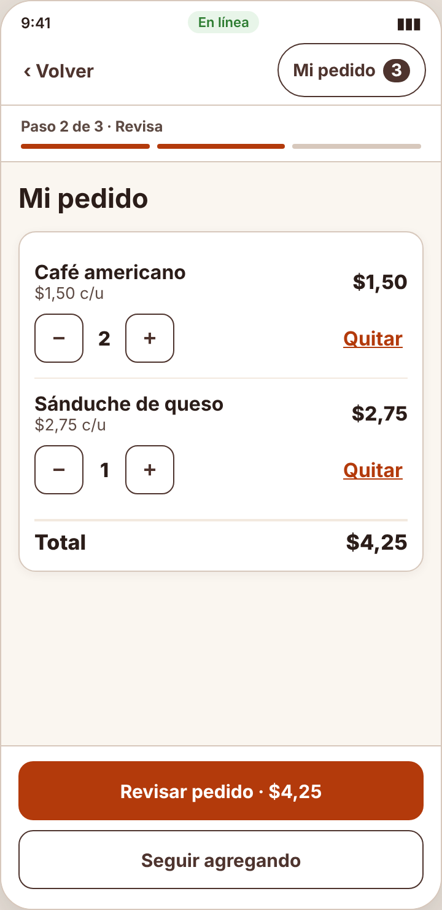
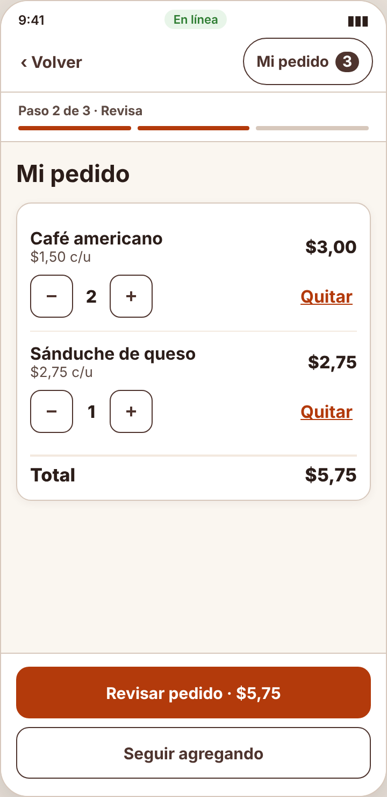
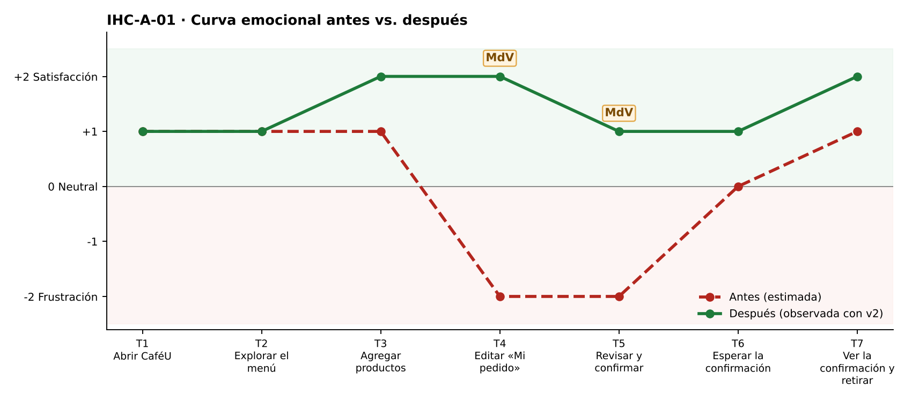

# Fase 4 · Prueba cognitiva y mejora — IHC-A-01 · CaféU · Total que se actualiza en un pedido rápido

**Moderador:** Acaro Ibujés Pedro Sebastián · **Observador:** Vinces Cueva Boris Yussef

| Elemento | Detalle |
|---|---|
| Participante | **PX-01** · Estudiante de 5.º semestre de otro equipo (Grupo 1), usa el celular a diario. No participó en el diseño. |
| Consigna (sin ayudas) | «Agregar café y sánduche; confirmar un pedido.» |
| Condición | Solo dispone de 3 minutos y utiliza pantalla de 360 px. |
| Prototipo | `prototipo/v1/` y luego `prototipo/v2/` (misma tarea). |
| Registro | Tiempo, errores, pausas > 3 s, resultado y cita textual. |

| Versión | Tiempo | Errores | Pausas | Resultado | Cita textual |
|---|---|---|---|---|---|
| v1 | 142 s | 2 | 2 (8 s al ver el total; 6 s antes de confirmar) | Completó, pero confirmó $4,25 cuando pidió 2 cafés ($5,75) | «¿Por qué sigue diciendo 4,25 si puse dos cafés?» |
| v2 | 88 s | 0 | 0 | Completó y confirmó $5,75 correcto | «Ahí sí cambia el total, rápido.» |

## Observaciones con v1
- Tocó «+» en Café americano: la cantidad pasó a 2, pero subtotal y total siguieron en $1,50 y $4,25.
- Se detuvo 8 s mirando el total y sumó en voz alta.
- Confirmó con $4,25 por falta de tiempo.

## Hallazgo corregido (Issue #1)
**El total no se recalcula al cambiar cantidades (Issue #1).** Cambio en v2: Subtotal y total se recalculan en `renderCart()` con `total()` en cada cambio; el botón muestra el total vigente.

| Antes (v1) | Después (v2) |
|---|---|
|  |  |
| Total en $4,25 con 2 cafés (v1) | Total recalculado a $5,75 (v2) |

## Mejora demostrada frente a estimada
| Mejora | Tipo | Evidencia |
|---|---|---|
| Tiempo 142 s → 88 s | **Demostrada** | Misma tarea y participante, cronometrada. |
| Errores 2 → 0 | **Demostrada** | Registro de observación. |
| Resultado: «Completó, pero confirmó $4,25 cuando pidió 2 cafés ($5,75)» → «Completó y confirmó $5,75 correcto» | **Demostrada** | Observación y capturas. |
| Emoción en momentos de verdad: T4 −2 😟 → +2 😊; T5 −2 😟 → +1 | Inferida de pausas y cita | `diagramas/curva-despues.png` |
| Generalización a otros usuarios | Estimada | Una sesión; requiere más participantes. |

