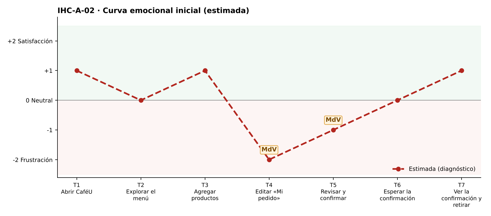

# Fase 1 · Diagnóstico emocional — IHC-A-02 · CaféU · Editar y finalizar un pedido solo con teclado

**Responsable de la tarjeta:** Acaro Ibujés Pedro Sebastián · **Revisor:** Vinces Cueva Boris Yussef · **Issue:** #2

## 1. Tarjeta
| Campo | Contenido |
|---|---|
| Persona usuaria | Estudiante que utiliza teclado por una lesión temporal |
| Tarea crítica | Editar un pedido y finalizar sin ratón |
| Restricción obligatoria | Tabulación, Enter y Escape como medios de interacción |
| Fallo adicional específico | El botón Quitar no tiene nombre accesible ni confirmación |
| Repositorio base | Sax300-cpu/HCI-2026-G2 (CaféU: requisitos, sitemap, user flow confirmar/editar, cinco wireframes; carpeta presentacion) |
| Repositorio complementario | maribelsailema/HCI_2026_G1 (Dashboard UX) |

## 2. Touchpoints
Siete touchpoints del recorrido de la tarea crítica sobre la interfaz de referencia. En esta fase las emociones son **estimadas**; las observadas están en `pruebas/sesion.md`.

| N.º | Touchpoint | Qué ocurre | Emoción estimada | Tipo | Momento de verdad |
|---|---|---|---|---|---|
| T1 | Abrir CaféU | Entra con Tab; el primer foco es «Saltar al contenido». | +1 | Estimado | — |
| T2 | Explorar el menú | Recorre el menú con Tab. | 0 😐 | Estimado | — |
| T3 | Agregar productos | Agrega con Enter. | +1 | Estimado | — |
| T4 | Editar «Mi pedido» | Cambia cantidades y quita un producto. | −2 😟 | Estimado | **Sí** |
| T5 | Revisar y confirmar | Revisa y confirma con Enter. | −1 | Estimado | **Sí** |
| T6 | Esperar la confirmación | Espera con el foco en el botón bloqueado. | 0 😐 | Estimado | — |
| T7 | Ver la confirmación y retirar | Lee la confirmación. | +1 | Estimado | — |

## 3. Momentos de verdad
1. **T4 · Editar «Mi pedido».** «Editar Mi pedido»: el lector anuncia solo «botón» en Quitar y el producto desaparece sin preguntar.
2. **T5 · Revisar y confirmar.** «Revisar y confirmar»: tras quitar, el foco se pierde y debe volver a tabular desde arriba.

## 4. Curva emocional inicial

## 5. Fallos priorizados
Prioridad = severidad de Nielsen × frecuencia esperada.

| N.º | Fallo | Heurística de Nielsen | Gestalt / carga cognitiva | Severidad | Frecuencia | Prioridad | Decisión | Seguimiento |
|---|---|---|---|---|---|---|---|---|
| 1 | «Quitar» es un ícono ✕ sin nombre accesible y elimina sin confirmar | N3 Control y libertad; N5 Prevención de errores; WCAG 4.1.2 | Carga cognitiva: adivinar qué hace un ícono | 4 · Catastrófico | Alta | P1 | Botón con texto/nombre «Quitar X del pedido» y confirmación (v2). | Issue #2 |
| 2 | Tras quitar, el foco vuelve al inicio de la página | WCAG 2.4.3 Orden del foco; N1 | Carga cognitiva: recorrer otra vez el encabezado | 3 · Grave | Media | P2 | Restaurar el foco al siguiente producto o al título. | Tarea de la issue #2 |
| 3 | Escape no cancela ni vuelve | N3 Control y libertad; N7 Flexibilidad | — | 2 · Menor | Media | P3 | Escape vuelve a la pantalla anterior o cancela el diálogo. | Tarea de la issue #2 |

## 6. Estimación frente a observación
| Afirmación | Tipo | Cómo se comprueba |
|---|---|---|
| ««Quitar» es un ícono ✕ sin nombre accesible y elimina sin confirmar» afecta la tarea crítica. | Estimación | Prueba cognitiva con v1 (tiempo, errores, pausas, cita). |
| Los momentos de verdad son T4 y T5. | Estimación | Pausas y comentarios de la prueba. |
| La curva mejora tras la corrección. | Estimación | Misma tarea con v2 (`curva-despues.png`). |

## 7. Principio del repositorio complementario
Visibilidad del estado del Dashboard UX: indicador «Paso n de 3» y anuncios de estado en aria-live.
