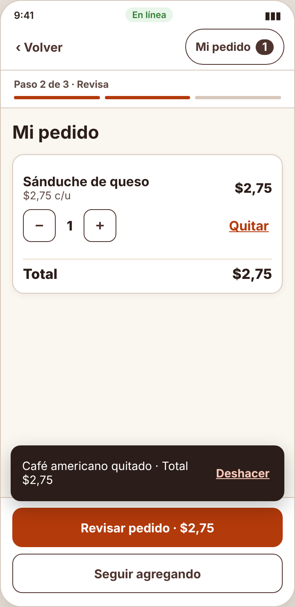
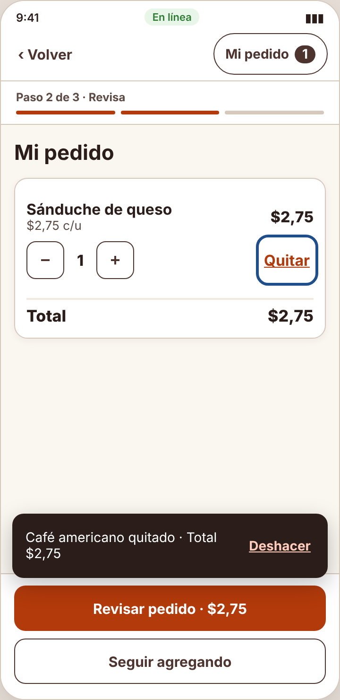

# Incidencia — IHC-A-02 · CaféU · Editar y finalizar un pedido solo con teclado

| Campo | Detalle |
|---|---|
| Incidencia (minuto 100) | Hacer identificables y operables los controles; restaurar foco después de quitar |
| Responsable / revisor | Acaro Ibujés Pedro Sebastián / Vinces Cueva Boris Yussef |
| Requisito nuevo | **RF-07** — Todos los controles tienen nombre accesible propio (−, +, Quitar, Info) y, al quitar, el foco va al siguiente producto o al título. |
| Criterio | Al quitar con Enter el foco queda en el «Quitar» del siguiente producto; − y + anuncian «Disminuir/Aumentar cantidad de X». |
| Flujo | `diagramas/user-flow.png` (nodos en naranja) |
| Cambio en el prototipo | Todos los controles (−, +, cantidad, Info) tienen nombre propio; `doQuit()` mueve el foco al «Quitar» del siguiente producto o al título y anuncia «X quitado. Total $Y». |
| Prueba | Tras quitar, el foco quedó en el siguiente producto; finalizó sin volver a tabular — 81 s, 0 errores. Cita: «No tuve que empezar desde arriba.» |
| Commit | Rama `fix/pedro-incidencias-01-03`, posterior a la entrega, con «Closes #» de la issue de la incidencia |

| Antes (v2) | Después (v2 con incidencia) |
|---|---|
|  |  |
