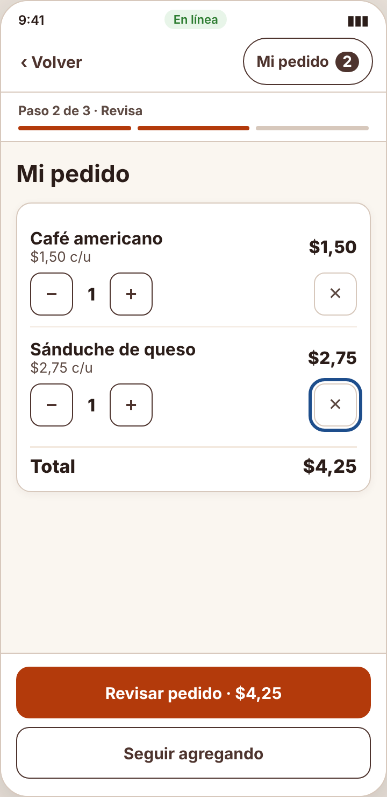
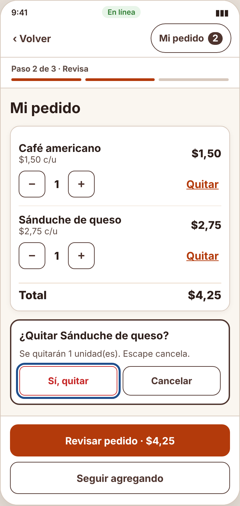
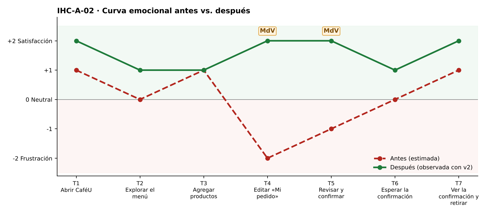

# Fase 4 · Prueba cognitiva y mejora — IHC-A-02 · CaféU · Editar y finalizar un pedido solo con teclado

**Moderador:** Acaro Ibujés Pedro Sebastián · **Observador:** Vinces Cueva Boris Yussef

| Elemento | Detalle |
|---|---|
| Participante | **PX-02** · Estudiante de otro equipo (Grupo 1); se le pidió usar solo teclado (Tab, Enter, Escape). No participó en el diseño. |
| Consigna (sin ayudas) | «Editar un pedido y finalizar sin ratón.» |
| Condición | Tabulación, Enter y Escape como medios de interacción. |
| Prototipo | `prototipo/v1/` y luego `prototipo/v2/` (misma tarea). |
| Registro | Tiempo, errores, pausas > 3 s, resultado y cita textual. |

| Versión | Tiempo | Errores | Pausas | Resultado | Cita textual |
|---|---|---|---|---|---|
| v1 | 171 s | 3 | 3 (10 s en el ✕; 7 s tras quitar; 5 s al volver a tabular) | Completó, pero quitó el café por error y tuvo que volver al menú | «¿Ese botón qué hace? Se borró sin preguntarme.» |
| v2 | 104 s | 1 | 1 (5 s tras quitar, foco al inicio) | Completó; la confirmación evitó quitar por error | «Me preguntó antes de quitar, bien.» |
| v2 con incidencia | 81 s | 0 | 0 | Tras quitar, el foco quedó en el siguiente producto; finalizó sin volver a tabular | «No tuve que empezar desde arriba.» |

## Observaciones con v1
- Tab llegó a un botón que el lector anunció solo como «botón».
- Pulsó Enter y el Café americano desapareció sin aviso de confirmación.
- El foco volvió al inicio; tabuló 9 veces para regresar a la lista.

## Hallazgo corregido (Issue #2)
**«Quitar» sin nombre accesible ni confirmación (Issue #2).** Cambio en v2: El botón dice «Quitar» con `aria-label="Quitar X del pedido"` y abre un diálogo `role="alertdialog"` con «Sí, quitar / Cancelar»; Escape cancela.

| Antes (v1) | Después (v2) |
|---|---|
|  |  |
| Botón ✕ sin nombre enfocado (v1) | Confirmación «¿Quitar Sánduche de queso?» (v2) |

## Mejora demostrada frente a estimada
| Mejora | Tipo | Evidencia |
|---|---|---|
| Tiempo 171 s → 104 s | **Demostrada** | Misma tarea y participante, cronometrada. |
| Errores 3 → 1 | **Demostrada** | Registro de observación. |
| Resultado: «Completó, pero quitó el café por error y tuvo que volver al menú» → «Completó; la confirmación evitó quitar por error» | **Demostrada** | Observación y capturas. |
| Emoción en momentos de verdad: T4 −2 😟 → +2 😊; T5 −1 → +2 😊 | Inferida de pausas y cita | `diagramas/curva-despues.png` |
| Generalización a otros usuarios | Estimada | Una sesión; requiere más participantes. |

## Prueba de la incidencia
«Anunciar producto eliminado, devolver foco a control pertinente y permitir Deshacer simulado.» — Tras quitar, el foco quedó en el siguiente producto; finalizó sin volver a tabular (81 s, 0 errores). Cita: «No tuve que empezar desde arriba.» Evidencia: `evidencias/incidencia/`.
