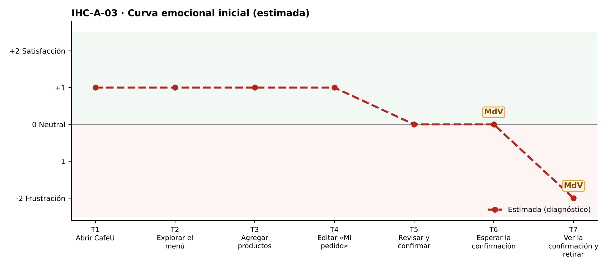

# Fase 1 · Diagnóstico emocional — IHC-A-03 · CaféU · Confirmación verificable en un dispositivo compartido

**Responsable de la tarjeta:** Acaro Ibujés Pedro Sebastián · **Revisor:** Vinces Cueva Boris Yussef · **Issue:** #3

## 1. Tarjeta
| Campo | Contenido |
|---|---|
| Persona usuaria | Estudiante que comparte dispositivo y debe salir rápido |
| Tarea crítica | Confirmar pedido y comprobar que se recibió |
| Restricción obligatoria | No puede exponerse un número personal ni guardar datos sensibles |
| Fallo adicional específico | La pantalla dice «Listo» pero no muestra número ni resumen |
| Repositorio base | Sax300-cpu/HCI-2026-G2 (CaféU: requisitos, sitemap, user flow confirmar/editar, cinco wireframes; carpeta presentacion) |
| Repositorio complementario | maribelsailema/HCI_2026_G1 (Dashboard UX) |

## 2. Touchpoints
Siete touchpoints del recorrido de la tarea crítica sobre la interfaz de referencia. En esta fase las emociones son **estimadas**; las observadas están en `pruebas/sesion.md`.

| N.º | Touchpoint | Qué ocurre | Emoción estimada | Tipo | Momento de verdad |
|---|---|---|---|---|---|
| T1 | Abrir CaféU | Usa el celular de un compañero; ve aviso «sin datos personales». | +1 | Estimado | — |
| T2 | Explorar el menú | Elige productos. | +1 | Estimado | — |
| T3 | Agregar productos | Agrega café y sánduche. | +1 | Estimado | — |
| T4 | Editar «Mi pedido» | Revisa cantidades. | +1 | Estimado | — |
| T5 | Revisar y confirmar | Confirma. | 0 😐 | Estimado | — |
| T6 | Esperar la confirmación | Espera el envío. | 0 😐 | Estimado | **Sí** |
| T7 | Ver la confirmación y retirar | Comprueba que se recibió y sale. | −2 😟 | Estimado | **Sí** |

## 3. Momentos de verdad
1. **T6 · Esperar la confirmación.** «Esperar la confirmación»: no distingue si su toque se registró o solo se pulsó.
2. **T7 · Ver la confirmación y retirar.** «Ver la confirmación»: «Listo» sin número ni resumen; no puede probar en caja que pidió.

## 4. Curva emocional inicial

## 5. Fallos priorizados
Prioridad = severidad de Nielsen × frecuencia esperada.

| N.º | Fallo | Heurística de Nielsen | Gestalt / carga cognitiva | Severidad | Frecuencia | Prioridad | Decisión | Seguimiento |
|---|---|---|---|---|---|---|---|---|
| 1 | La confirmación dice «Listo» sin número ni resumen | N1 Visibilidad del estado; N9 Reconocer y recuperarse | Carga cognitiva: debe recordar qué pidió | 4 · Catastrófico | Alta | P1 | Mostrar número de pedido, resumen y total (v2). | Issue #3 |
| 2 | Riesgo de exponer datos personales en un dispositivo compartido | N5 Prevención de errores; privacidad | — | 3 · Grave | Media | P2 | No pedir teléfono ni cédula; botón «Salir y borrar este pedido». | Tarea de la issue #3 |
| 3 | Mientras se envía no queda claro que aún no está confirmado | N1 Visibilidad del estado | Gestalt: semejanza — «Enviando» y «Listo» se ven iguales | 2 · Menor | Media | P3 | Estado «Enviando…» con barra y botón bloqueado, distinto del éxito. | Tarea de la issue #3 |

## 6. Estimación frente a observación
| Afirmación | Tipo | Cómo se comprueba |
|---|---|---|
| «La confirmación dice «Listo» sin número ni resumen» afecta la tarea crítica. | Estimación | Prueba cognitiva con v1 (tiempo, errores, pausas, cita). |
| Los momentos de verdad son T6 y T7. | Estimación | Pausas y comentarios de la prueba. |
| La curva mejora tras la corrección. | Estimación | Misma tarea con v2 (`curva-despues.png`). |

## 7. Principio del repositorio complementario
Momentos de verdad y curva emocional del Dashboard UX aplicados a la confirmación.
