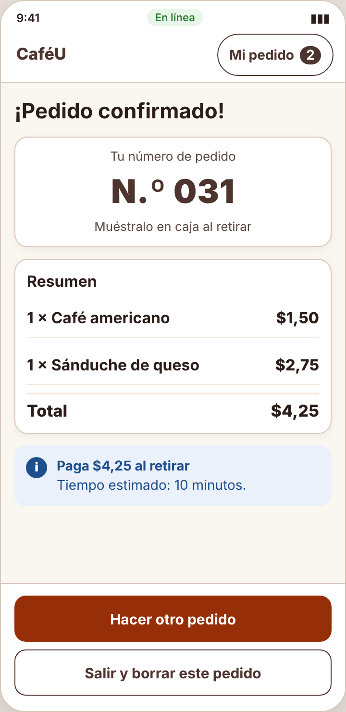
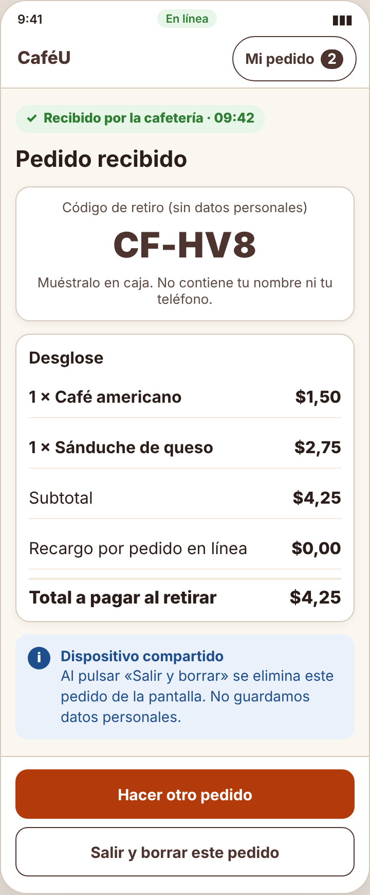

# Incidencia — IHC-A-03 · CaféU · Confirmación verificable en un dispositivo compartido

| Campo | Detalle |
|---|---|
| Incidencia (minuto 100) | Mostrar un identificador simulado, desglose y estado inequívoco de pedido recibido |
| Responsable / revisor | Acaro Ibujés Pedro Sebastián / Vinces Cueva Boris Yussef |
| Requisito nuevo | **RF-07** — Mostrar un código de retiro sin datos personales, el desglose (productos, subtotal, recargo, total) y el estado inequívoco «Recibido por la cafetería» con hora. |
| Criterio | La pantalla final muestra «✓ Recibido por la cafetería · 09:42», código CF-XXX y desglose. |
| Flujo | `diagramas/user-flow.png` (nodos en naranja) |
| Cambio en el prototipo | `renderOk()` muestra el estado «✓ Recibido por la cafetería · hora», el código de retiro `code()` (sin datos personales) y el desglose; «Salir y borrar este pedido» limpia la pantalla. |
| Prueba | Leyó «Recibido por la cafetería», el código CF y el desglose; salió y borró — 68 s, 0 errores. Cita: «Clarísimo que sí llegó.» |
| Commit | Rama `fix/pedro-incidencias-01-03`, posterior a la entrega, con «Closes #» de la issue de la incidencia |

| Antes (v2) | Después (v2 con incidencia) |
|---|---|
|  |  |
