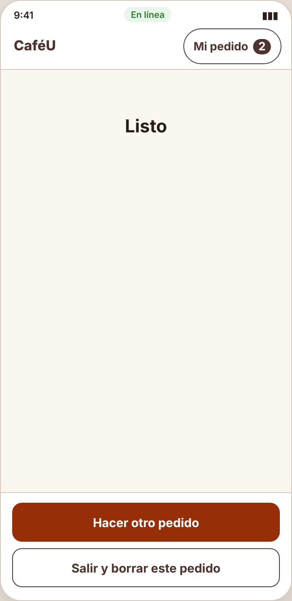
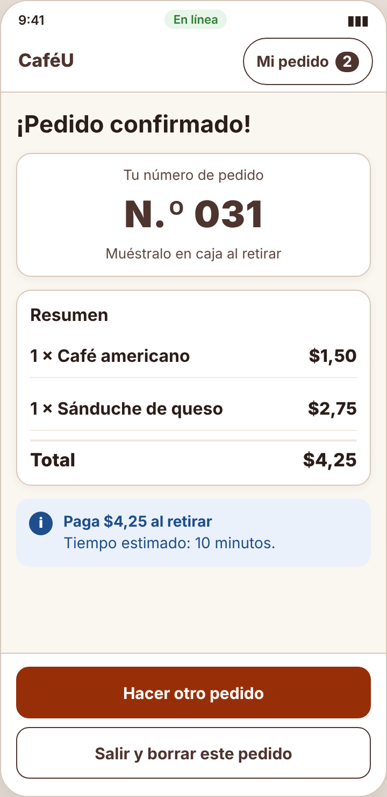
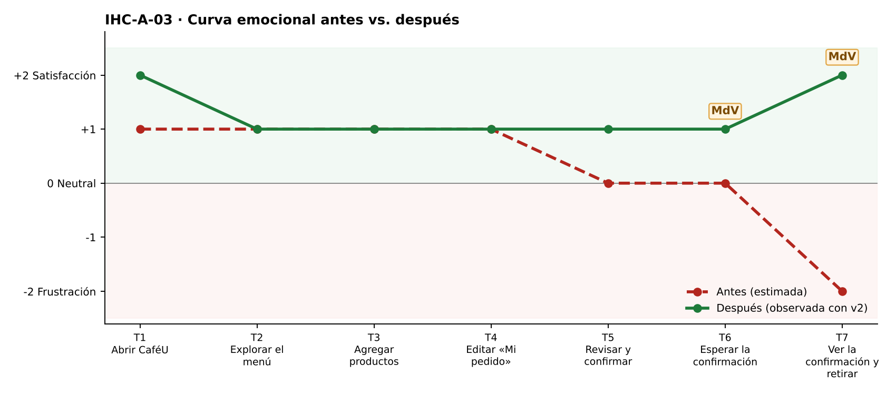

# Fase 4 · Prueba cognitiva y mejora — IHC-A-03 · CaféU · Confirmación verificable en un dispositivo compartido

**Moderador:** Acaro Ibujés Pedro Sebastián · **Observador:** Vinces Cueva Boris Yussef

| Elemento | Detalle |
|---|---|
| Participante | **PX-03** · Estudiante de otro equipo (Grupo 1) usando un teléfono prestado. No participó en el diseño. |
| Consigna (sin ayudas) | «Confirmar pedido y comprobar que se recibió.» |
| Condición | No puede exponerse un número personal ni guardar datos sensibles. |
| Prototipo | `prototipo/v1/` y luego `prototipo/v2/` (misma tarea). |
| Registro | Tiempo, errores, pausas > 3 s, resultado y cita textual. |

| Versión | Tiempo | Errores | Pausas | Resultado | Cita textual |
|---|---|---|---|---|---|
| v1 | 96 s | 1 | 2 (9 s en «Listo»; 6 s buscando el número) | Confirmó, pero no pudo decir qué pidió ni con qué número retirar | «¿Listo qué? ¿Ya está o tengo que hacer algo más?» |
| v2 | 71 s | 0 | 0 | Leyó el N.º 031 y el resumen | «Ya tengo el número para la caja.» |
| v2 con incidencia | 77 s | 0 | 1 (8 s de espera con «Pendiente») | Pulsó dos veces durante la espera; el botón estaba bloqueado, vio «Pendiente» y luego un solo pedido recibido | «Decía pendiente, así que esperé; salió un solo pedido.» |

## Observaciones con v1
- Al terminar vio solo «Listo».
- Volvió atrás buscando el número.
- Preguntó si debía enseñar algo en caja.

## Hallazgo corregido (Issue #3)
**«Listo» sin número ni resumen (Issue #3).** Cambio en v2: `renderOk()` muestra «¡Pedido confirmado!», N.º de pedido, resumen y total en lugar de solo «Listo».

| Antes (v1) | Después (v2) |
|---|---|
|  |  |
| Pantalla final con solo «Listo» (v1) | Confirmación con N.º y resumen (v2) |

## Mejora demostrada frente a estimada
| Mejora | Tipo | Evidencia |
|---|---|---|
| Tiempo 96 s → 71 s | **Demostrada** | Misma tarea y participante, cronometrada. |
| Errores 1 → 0 | **Demostrada** | Registro de observación. |
| Resultado: «Confirmó, pero no pudo decir qué pidió ni con qué número retirar» → «Leyó el N.º 031 y el resumen» | **Demostrada** | Observación y capturas. |
| Emoción en momentos de verdad: T6 0 😐 → +1; T7 −2 😟 → +2 😊 | Inferida de pausas y cita | `diagramas/curva-despues.png` |
| Generalización a otros usuarios | Estimada | Una sesión; requiere más participantes. |

## Prueba de la incidencia
«Deshabilitar repetición, mostrar pendiente y resolverlo a confirmado o no confirmado sin duplicar.» — Pulsó dos veces durante la espera; el botón estaba bloqueado, vio «Pendiente» y luego un solo pedido recibido (77 s, 0 errores). Cita: «Decía pendiente, así que esperé; salió un solo pedido.» Evidencia: `evidencias/incidencia/`.
