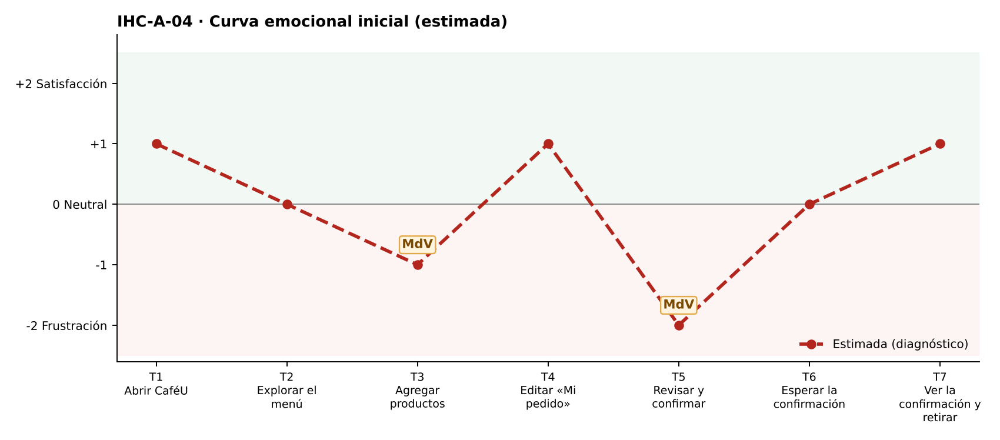

# Fase 1 · Diagnóstico emocional — IHC-A-04 · CaféU · Advertencia de alérgenos antes de confirmar

**Responsable de la tarjeta:** Mora Beltrán Santiago Sebastián · **Revisor:** Acaro Ibujés Pedro Sebastián · **Issue:** #4

## 1. Tarjeta
| Campo | Contenido |
|---|---|
| Persona usuaria | Estudiante con alergia alimentaria declarada |
| Tarea crítica | Consultar un producto y corregir el pedido |
| Restricción obligatoria | La advertencia de alérgenos debe ser perceptible antes de confirmar |
| Fallo adicional específico | Se permite confirmar sin leer la advertencia de ingredientes |
| Repositorio base | Sax300-cpu/HCI-2026-G2 (CaféU: requisitos, sitemap, user flow confirmar/editar, cinco wireframes; carpeta presentacion) |
| Repositorio complementario | maribelsailema/HCI_2026_G1 (Dashboard UX) |

## 2. Touchpoints
Siete touchpoints del recorrido de la tarea crítica sobre la interfaz de referencia. En esta fase las emociones son **estimadas**; las observadas están en `pruebas/sesion.md`.

| N.º | Touchpoint | Qué ocurre | Emoción estimada | Tipo | Momento de verdad |
|---|---|---|---|---|---|
| T1 | Abrir CaféU | Declara su alergia (frutos secos) al iniciar. | +1 | Estimado | — |
| T2 | Explorar el menú | Explora el menú. | 0 😐 | Estimado | — |
| T3 | Agregar productos | Consulta ingredientes en «Info». | −1 | Estimado | **Sí** |
| T4 | Editar «Mi pedido» | Agrega café, sánduche y brownie. | +1 | Estimado | — |
| T5 | Revisar y confirmar | Revisa y confirma. | −2 😟 | Estimado | **Sí** |
| T6 | Esperar la confirmación | Espera el envío. | 0 😐 | Estimado | — |
| T7 | Ver la confirmación y retirar | Ve la confirmación. | +1 | Estimado | — |

## 3. Momentos de verdad
1. **T3 · Agregar productos.** «Consultar ingredientes»: la advertencia está escondida en «Info».
2. **T5 · Revisar y confirmar.** «Revisar y confirmar»: puede confirmar un producto con su alérgeno sin ningún aviso.

## 4. Curva emocional inicial

## 5. Fallos priorizados
Prioridad = severidad de Nielsen × frecuencia esperada.

| N.º | Fallo | Heurística de Nielsen | Gestalt / carga cognitiva | Severidad | Frecuencia | Prioridad | Decisión | Seguimiento |
|---|---|---|---|---|---|---|---|---|
| 1 | Se puede confirmar sin ver la advertencia de alérgenos | N5 Prevención de errores; N1 | Carga cognitiva: recordar ingredientes leídos antes | 4 · Catastrófico | Alta | P1 | Aviso en menú y en «Revisa y confirma» + casilla de lectura obligatoria (v2). | Issue #4 |
| 2 | La alergia declarada no se relaciona con los productos | N2 Relación con el mundo real; N6 | Gestalt: proximidad — el aviso no está junto al producto | 3 · Grave | Media | P2 | Etiqueta «⚠ Contiene frutos secos» junto al producto. | Tarea de la issue #4 |
| 3 | El color rojo es la única señal de peligro | WCAG 1.4.1 Uso del color | — | 2 · Menor | Media | P3 | Ícono + texto «Contiene…», no solo color. | Tarea de la issue #4 |

## 6. Estimación frente a observación
| Afirmación | Tipo | Cómo se comprueba |
|---|---|---|
| «Se puede confirmar sin ver la advertencia de alérgenos» afecta la tarea crítica. | Estimación | Prueba cognitiva con v1 (tiempo, errores, pausas, cita). |
| Los momentos de verdad son T3 y T5. | Estimación | Pausas y comentarios de la prueba. |
| La curva mejora tras la corrección. | Estimación | Misma tarea con v2 (`curva-despues.png`). |

## 7. Principio del repositorio complementario
Momentos de verdad del Dashboard UX: la confirmación se trata como momento de verdad con revisión previa (checklist).
