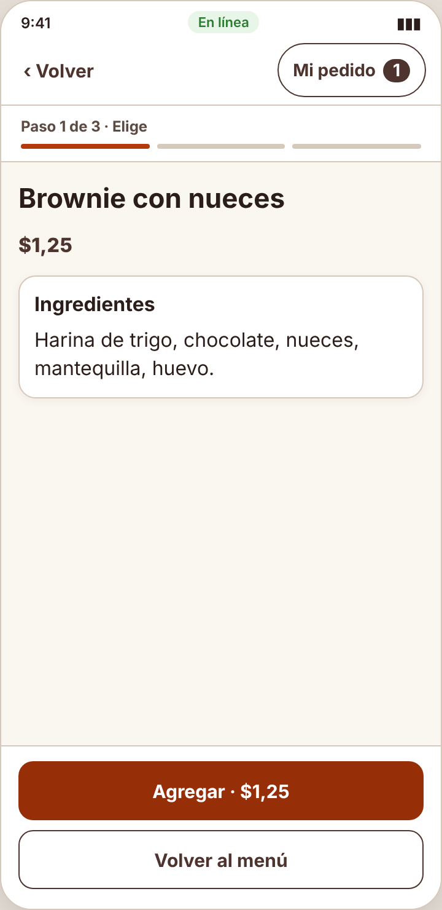
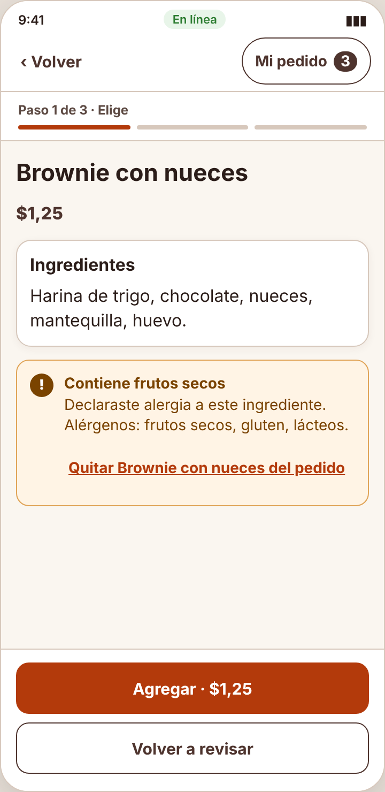

# Incidencia sorpresa — IHC-A-04 · CaféU · Advertencia de alérgenos antes de confirmar

## Alergia añadida
| Campo | Detalle |
|---|---|
| Evento imprevisto | El producto seleccionado ahora contiene un alérgeno no visible en el detalle. |
| Cambio obligatorio | Mostrar ingrediente/alerta antes de confirmar y ofrecer volver al detalle sin vaciar carrito. |
| Evidencias pedidas | Captura, rama de editar en flujo, prueba de comprensión. |
| Responsable / revisor | Mora Beltrán Santiago Sebastián / Acaro Ibujés Pedro Sebastián |
| Issue | «IHC-A-04 · Incidencia: Alergia añadida» (hora del anuncio y SHA del commit registrados en la issue y en el PR) |

## Respuesta
| Evidencia | Dónde está |
|---|---|
| Requisito nuevo **RF-07** | Mostrar el alérgeno en el detalle y una alerta accesible antes de confirmar, con «Ver el detalle» y «Volver a editar» sin vaciar el carrito. — `docs/requisitos.md`, `docs/trazabilidad.md` |
| Flujo / wireframe actualizados | `diagramas/user-flow.png` (nodos en naranja) y `wireframes/wf-05-incidencia.png` |
| Cambio visible en el prototipo | `openDetail()` muestra la alerta del alérgeno (`role="alert"`) con «Quitar del pedido»; la advertencia de «Revisa y confirma» ofrece «Ver el detalle de X» y «Volver a editar sin perder el pedido»; el carrito no se vacía. — `prototipo/v2/index.html` |
| Prueba funcional | Desde la advertencia abrió el detalle, leyó «Contiene frutos secos», quitó el brownie y volvió a revisar con café y sánduche (88 s, 0 errores). Cita: «En el detalle ya sale que tiene nueces, lo saco.» — `pruebas/sesion.md` |
| Antes / después | `evidencias/incidencia/` |

| Commit y revisión | Rama de incidencias de Santiago, commit posterior al anuncio, PR revisado por Pedro |
| Defensa | ¿Cómo prueba que el usuario comprende y puede corregir su elección? — `docs/defensa.md` |

## Verificación (rúbrica de la incidencia, 0,25)
| Criterio | Cumplimiento |
|---|---|
| Funcionamiento comprobable (0,08) | En «Revisa y confirma», «Ver el detalle de Brownie» abre el detalle con la alerta y «Quitar del pedido»; café y sánduche se conservan. |
| Requisito, flujo o wireframe actualizado (0,05) | RF-07, user flow y `wf-05-incidencia.png` |
| Prueba y evidencia antes/después (0,05) | `pruebas/sesion.md` y `evidencias/incidencia/` |
| Commit posterior y revisión de compañero (0,04) | PR de incidencias revisado por Acaro Ibujés Pedro Sebastián |
| Defensa individual (0,03) | `docs/defensa.md` |

| Antes (v2) | Después (v2 con la incidencia) |
|---|---|
|  |  |
