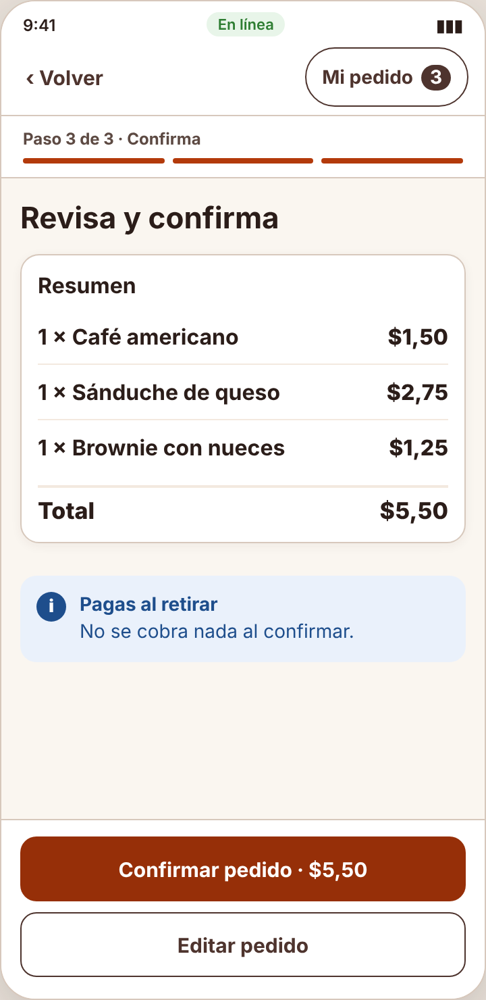
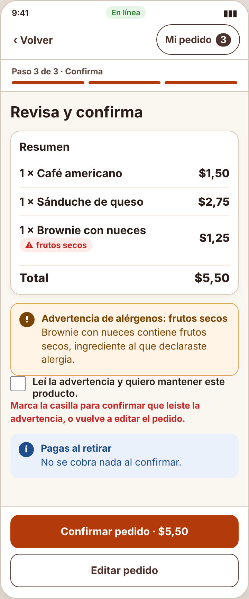
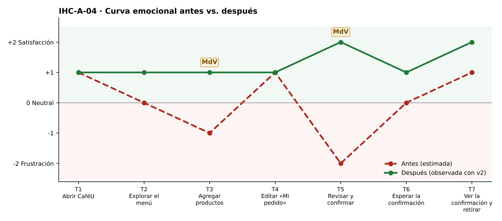

# Fase 4 · Prueba cognitiva y mejora — IHC-A-04 · CaféU · Advertencia de alérgenos antes de confirmar

**Moderador:** Mora Beltrán Santiago Sebastián · **Observador:** Acaro Ibujés Pedro Sebastián

| Elemento | Detalle |
|---|---|
| Participante | **PX-04** · Estudiante de otro equipo (Grupo 3); se le indicó que es alérgico a frutos secos. No participó en el diseño. |
| Consigna (sin ayudas) | «Consultar un producto y corregir el pedido.» |
| Condición | La advertencia de alérgenos debe ser perceptible antes de confirmar. |
| Prototipo | `prototipo/v1/` y luego `prototipo/v2/` (misma tarea). |
| Registro | Tiempo, errores, pausas > 3 s, resultado y cita textual. |

| Versión | Tiempo | Errores | Pausas | Resultado | Cita textual |
|---|---|---|---|---|---|
| v1 | 118 s | 1 | 1 (7 s en «Info») | Confirmó el pedido con el brownie (contiene nueces) sin ver aviso | «No vi nada de alergias, pensé que estaba bien.» |
| v2 | 97 s | 0 | 1 (6 s leyendo la advertencia) | Vio la advertencia; desmarcó y volvió a «Mi pedido» por su cuenta | «Ah, el brownie tiene nueces, lo saco.» |
| v2 con incidencia | 88 s | 0 | 1 (5 s leyendo el detalle) | Desde la advertencia abrió el detalle, leyó «Contiene frutos secos», quitó el brownie y volvió a revisar con café y sánduche | «En el detalle ya sale que tiene nueces, lo saco.» |

## Observaciones con v1
- Agregó el brownie desde el menú: no había ninguna marca de alérgeno.
- En «Revisa y confirma» no apareció advertencia.
- Confirmó; al preguntarle, no sabía que tenía nueces.

## Hallazgo corregido (Issue #4)
**Confirmar sin leer la advertencia de alérgenos (Issue #4).** Cambio en v2: Etiqueta «⚠ Contiene…» en menú y pedido; en `renderReview()` aviso y casilla obligatoria; el clic de confirmar valida la casilla.

| Antes (v1) | Después (v2) |
|---|---|
|  |  |
| Revisa y confirma sin advertencia (v1) | Advertencia + casilla obligatoria (v2) |

## Mejora demostrada frente a estimada
| Mejora | Tipo | Evidencia |
|---|---|---|
| Tiempo 118 s → 97 s | **Demostrada** | Misma tarea y participante, cronometrada. |
| Errores 1 → 0 | **Demostrada** | Registro de observación. |
| Resultado: «Confirmó el pedido con el brownie (contiene nueces) sin ver aviso» → «Vio la advertencia; desmarcó y volvió a «Mi pedido» por su cuenta» | **Demostrada** | Observación y capturas. |
| Emoción en momentos de verdad: T3 −1 → +1; T5 −2 😟 → +2 😊 | Inferida de pausas y cita | `diagramas/curva-despues.png` |
| Generalización a otros usuarios | Estimada | Una sesión; requiere más participantes. |

## Prueba de la incidencia
«Mostrar ingrediente/alerta antes de confirmar y ofrecer volver al detalle sin vaciar carrito.» — Desde la advertencia abrió el detalle, leyó «Contiene frutos secos», quitó el brownie y volvió a revisar con café y sánduche (88 s, 0 errores). Cita: «En el detalle ya sale que tiene nueces, lo saco.» Evidencia: `evidencias/incidencia/`.
