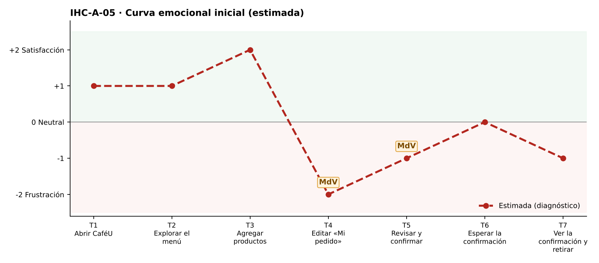

# Fase 1 · Diagnóstico emocional — IHC-A-05 · CaféU · Pedido dentro de un presupuesto de USD 4,25

**Responsable de la tarjeta:** Mora Beltrán Santiago Sebastián · **Revisor:** Acaro Ibujés Pedro Sebastián · **Issue:** #5

## 1. Tarjeta
| Campo | Contenido |
|---|---|
| Persona usuaria | Estudiante con presupuesto de USD 4,25 |
| Tarea crítica | Añadir productos, ajustar cantidades y revisar total |
| Restricción obligatoria | No exceder el presupuesto sin aviso claro |
| Fallo adicional específico | Una edición genera sobrecosto sin feedback |
| Repositorio base | Sax300-cpu/HCI-2026-G2 (CaféU: requisitos, sitemap, user flow confirmar/editar, cinco wireframes; carpeta presentacion) |
| Repositorio complementario | maribelsailema/HCI_2026_G1 (Dashboard UX) |

## 2. Touchpoints
Siete touchpoints del recorrido de la tarea crítica sobre la interfaz de referencia. En esta fase las emociones son **estimadas**; las observadas están en `pruebas/sesion.md`.

| N.º | Touchpoint | Qué ocurre | Emoción estimada | Tipo | Momento de verdad |
|---|---|---|---|---|---|
| T1 | Abrir CaféU | Ve su presupuesto de $4,25. | +1 | Estimado | — |
| T2 | Explorar el menú | Explora el menú con el medidor de gasto. | +1 | Estimado | — |
| T3 | Agregar productos | Agrega café ($1,50) y sánduche ($2,75) = $4,25. | +2 😊 | Estimado | — |
| T4 | Editar «Mi pedido» | Sube a 2 cafés. | −2 😟 | Estimado | **Sí** |
| T5 | Revisar y confirmar | Revisa el total. | −1 | Estimado | **Sí** |
| T6 | Esperar la confirmación | Espera la confirmación. | 0 😐 | Estimado | — |
| T7 | Ver la confirmación y retirar | Ve el total a pagar. | −1 | Estimado | — |

## 3. Momentos de verdad
1. **T4 · Editar «Mi pedido».** «Editar Mi pedido»: un «+» lo lleva a $5,75 sin aviso.
2. **T5 · Revisar y confirmar.** «Revisar y confirmar»: descubre el exceso tarde o no lo descubre.

## 4. Curva emocional inicial

## 5. Fallos priorizados
Prioridad = severidad de Nielsen × frecuencia esperada.

| N.º | Fallo | Heurística de Nielsen | Gestalt / carga cognitiva | Severidad | Frecuencia | Prioridad | Decisión | Seguimiento |
|---|---|---|---|---|---|---|---|---|
| 1 | Editar una cantidad excede el presupuesto sin feedback | N1 Visibilidad del estado; N5 Prevención de errores | Carga cognitiva: restar mentalmente del presupuesto | 4 · Catastrófico | Alta | P1 | Medidor y aviso «Te pasas por $X» en «Mi pedido» (v2). | Issue #5 |
| 2 | El medidor de presupuesto solo aparece en el menú | N6 Reconocer antes que recordar | Gestalt: continuidad — se pierde al cambiar de pantalla | 3 · Grave | Media | P2 | Medidor también en «Mi pedido» y «Revisa y confirma». | Tarea de la issue #5 |
| 3 | El exceso solo se indicaría con color | WCAG 1.4.1 | — | 2 · Menor | Media | P3 | Texto «Te pasas por $X» con ícono. | Tarea de la issue #5 |

## 6. Estimación frente a observación
| Afirmación | Tipo | Cómo se comprueba |
|---|---|---|
| «Editar una cantidad excede el presupuesto sin feedback» afecta la tarea crítica. | Estimación | Prueba cognitiva con v1 (tiempo, errores, pausas, cita). |
| Los momentos de verdad son T4 y T5. | Estimación | Pausas y comentarios de la prueba. |
| La curva mejora tras la corrección. | Estimación | Misma tarea con v2 (`curva-despues.png`). |

## 7. Principio del repositorio complementario
Curva emocional y momentos de verdad del Dashboard UX para identificar dónde nace la frustración.
