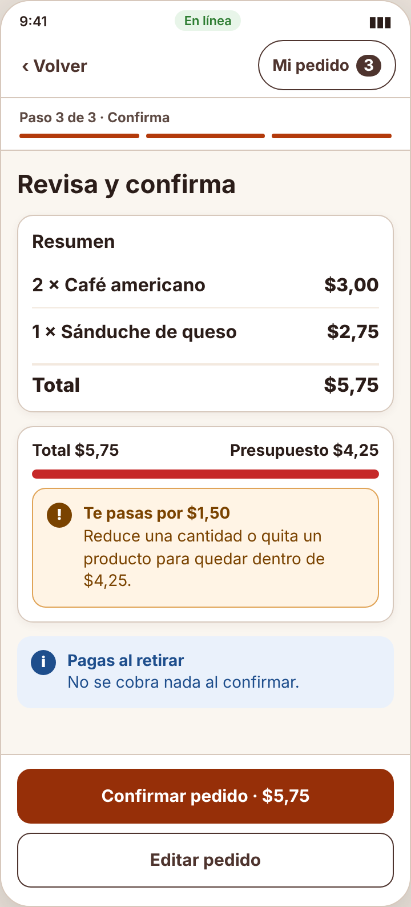
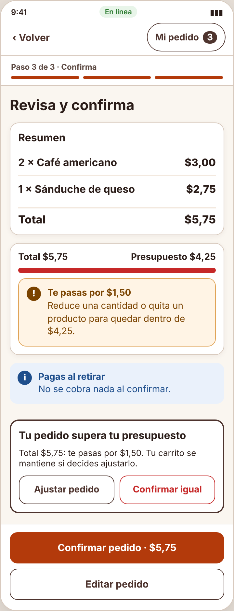

# Incidencia — IHC-A-05 · CaféU · Pedido dentro de un presupuesto de USD 4,25

| Campo | Detalle |
|---|---|
| Incidencia (minuto 100) | Avisar antes de confirmar y ofrecer ajustar el pedido manteniendo el carrito |
| Responsable / revisor | Mora Beltrán Santiago Sebastián / Acaro Ibujés Pedro Sebastián |
| Requisito nuevo | **RF-07** — Antes de confirmar un pedido sobre el presupuesto, avisar con la diferencia y ofrecer «Ajustar pedido» (conserva el carrito) o «Confirmar igual». |
| Criterio | Con $5,75, «Confirmar» abre el aviso; «Ajustar pedido» vuelve a «Mi pedido» con los 3 productos. |
| Flujo | `diagramas/user-flow.png` (nodos en naranja) |
| Cambio en el prototipo | En el clic de confirmar, si `total() > BUDGET`, se abre un diálogo con la diferencia y «Ajustar pedido» (vuelve a «Mi pedido» sin vaciar el carrito) o «Confirmar igual». |
| Prueba | Al confirmar con exceso eligió «Ajustar pedido»; el carrito se conservó — 82 s, 0 errores. Cita: «Bien que no se borró nada.» |
| Commit | Rama `fix/santiago-incidencias-04-06`, posterior a la entrega, con «Closes #» de la issue de la incidencia |

| Antes (v2) | Después (v2 con incidencia) |
|---|---|
|  |  |
