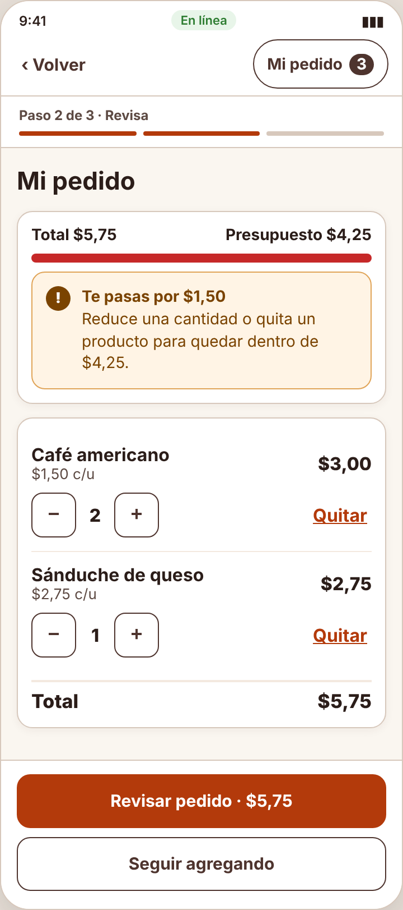
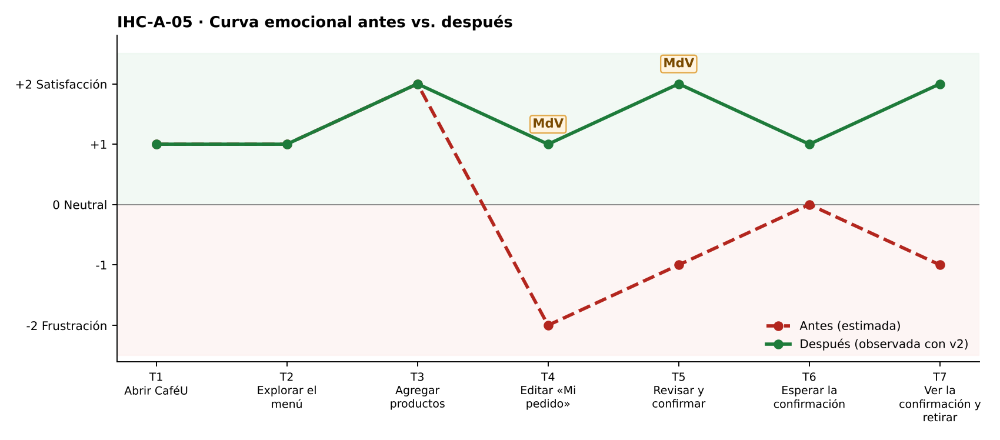

# Fase 4 · Prueba cognitiva y mejora — IHC-A-05 · CaféU · Pedido dentro de un presupuesto de USD 4,25

**Moderador:** Mora Beltrán Santiago Sebastián · **Observador:** Acaro Ibujés Pedro Sebastián

| Elemento | Detalle |
|---|---|
| Participante | **PX-05** · Estudiante de otro equipo (Grupo 3); se le dio un presupuesto de $4,25. No participó en el diseño. |
| Consigna (sin ayudas) | «Añadir productos, ajustar cantidades y revisar total.» |
| Condición | No exceder el presupuesto sin aviso claro. |
| Prototipo | `prototipo/v1/` y luego `prototipo/v2/` (misma tarea). |
| Registro | Tiempo, errores, pausas > 3 s, resultado y cita textual. |

| Versión | Tiempo | Errores | Pausas | Resultado | Cita textual |
|---|---|---|---|---|---|
| v1 | 109 s | 1 | 1 (6 s en «Revisa y confirma») | Confirmó $5,75 sin darse cuenta del exceso | «Pensé que seguía en 4,25.» |
| v2 | 86 s | 0 | 1 (4 s leyendo el aviso) | Vio «Te pasas por $1,50» y bajó a 1 café | «Me avisó al toque, bajo uno.» |
| v2 con incidencia | 82 s | 0 | 0 | Al confirmar con exceso eligió «Ajustar pedido»; el carrito se conservó | «Bien que no se borró nada.» |

## Observaciones con v1
- Agregó café y sánduche: el medidor del menú mostró $4,25 de $4,25.
- En «Mi pedido» pulsó «+» en café; el total pasó a $5,75 sin aviso.
- Confirmó sin revisar el total.

## Hallazgo corregido (Issue #5)
**Edición que genera sobrecosto sin feedback (Issue #5).** Cambio en v2: `budgetBox()` se pinta en «Mi pedido» y «Revisa y confirma» con medidor y «Te pasas por $X» al editar.

| Antes (v1) | Después (v2) |
|---|---|
|  |  |
| Total $5,75 sin aviso de presupuesto (v1) | Aviso «Te pasas por $1,50» al editar (v2) |

## Mejora demostrada frente a estimada
| Mejora | Tipo | Evidencia |
|---|---|---|
| Tiempo 109 s → 86 s | **Demostrada** | Misma tarea y participante, cronometrada. |
| Errores 1 → 0 | **Demostrada** | Registro de observación. |
| Resultado: «Confirmó $5,75 sin darse cuenta del exceso» → «Vio «Te pasas por $1,50» y bajó a 1 café» | **Demostrada** | Observación y capturas. |
| Emoción en momentos de verdad: T4 −2 😟 → +1; T5 −1 → +2 😊 | Inferida de pausas y cita | `diagramas/curva-despues.png` |
| Generalización a otros usuarios | Estimada | Una sesión; requiere más participantes. |

## Prueba de la incidencia
«Avisar antes de confirmar y ofrecer ajustar el pedido manteniendo el carrito» — Al confirmar con exceso eligió «Ajustar pedido»; el carrito se conservó (82 s, 0 errores). Cita: «Bien que no se borró nada.» Evidencia: `evidencias/incidencia/`.
