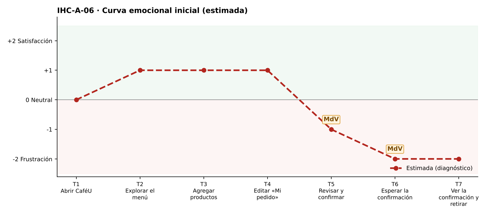

# Fase 1 · Diagnóstico emocional — IHC-A-06 · CaféU · Confirmación sin duplicados con red inestable

**Responsable de la tarjeta:** Mora Beltrán Santiago Sebastián · **Revisor:** Acaro Ibujés Pedro Sebastián · **Issue:** #6

## 1. Tarjeta
| Campo | Contenido |
|---|---|
| Persona usuaria | Estudiante con red móvil inestable |
| Tarea crítica | Confirmar pedido desde el teléfono |
| Restricción obligatoria | No se debe afirmar éxito mientras la confirmación está pendiente |
| Fallo adicional específico | Dos pulsaciones generan confirmaciones duplicadas |
| Repositorio base | Sax300-cpu/HCI-2026-G2 (CaféU: requisitos, sitemap, user flow confirmar/editar, cinco wireframes; carpeta presentacion) |
| Repositorio complementario | maribelsailema/HCI_2026_G1 (Dashboard UX) |

## 2. Touchpoints
Siete touchpoints del recorrido de la tarea crítica sobre la interfaz de referencia. En esta fase las emociones son **estimadas**; las observadas están en `pruebas/sesion.md`.

| N.º | Touchpoint | Qué ocurre | Emoción estimada | Tipo | Momento de verdad |
|---|---|---|---|---|---|
| T1 | Abrir CaféU | Abre CaféU con señal débil. | 0 😐 | Estimado | — |
| T2 | Explorar el menú | Explora el menú. | +1 | Estimado | — |
| T3 | Agregar productos | Agrega café y sánduche. | +1 | Estimado | — |
| T4 | Editar «Mi pedido» | Revisa el pedido. | +1 | Estimado | — |
| T5 | Revisar y confirmar | Pulsa «Confirmar». | −1 | Estimado | **Sí** |
| T6 | Esperar la confirmación | Espera con red lenta. | −2 😟 | Estimado | **Sí** |
| T7 | Ver la confirmación y retirar | Ve la confirmación. | −2 😟 | Estimado | — |

## 3. Momentos de verdad
1. **T5 · Revisar y confirmar.** «Revisar y confirmar»: con la red lenta pulsa dos veces porque no ve respuesta.
2. **T6 · Esperar la confirmación.** «Esperar la confirmación»: termina con dos pedidos registrados.

## 4. Curva emocional inicial

## 5. Fallos priorizados
Prioridad = severidad de Nielsen × frecuencia esperada.

| N.º | Fallo | Heurística de Nielsen | Gestalt / carga cognitiva | Severidad | Frecuencia | Prioridad | Decisión | Seguimiento |
|---|---|---|---|---|---|---|---|---|
| 1 | Dos pulsaciones generan dos pedidos | N5 Prevención de errores; N1 | Carga cognitiva: no sabe si su toque funcionó | 4 · Catastrófico | Alta | P1 | Bloquear el botón durante el envío (v2). | Issue #6 |
| 2 | No hay estado intermedio mientras la red responde | N1 Visibilidad del estado | Gestalt: semejanza — botón activo igual a antes | 3 · Grave | Media | P2 | «Enviando…» con spinner y barra. | Tarea de la issue #6 |
| 3 | Tras un corte no se sabe si el pedido se registró | N9 Recuperación de errores | — | 3 · Grave | Media | P3 | Mensaje de error con reintento seguro. | Tarea de la issue #6 |

## 6. Estimación frente a observación
| Afirmación | Tipo | Cómo se comprueba |
|---|---|---|
| «Dos pulsaciones generan dos pedidos» afecta la tarea crítica. | Estimación | Prueba cognitiva con v1 (tiempo, errores, pausas, cita). |
| Los momentos de verdad son T5 y T6. | Estimación | Pausas y comentarios de la prueba. |
| La curva mejora tras la corrección. | Estimación | Misma tarea con v2 (`curva-despues.png`). |

## 7. Principio del repositorio complementario
Stepper y visibilidad del estado del Dashboard UX: estados explícitos con ícono y texto.
