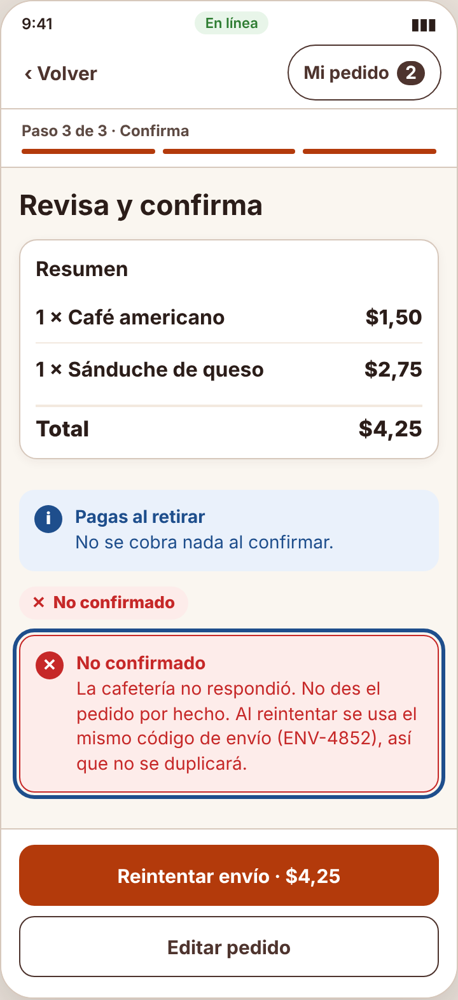

# Incidencia sorpresa — IHC-A-06 · CaféU · Confirmación sin duplicados con red inestable

## Falla de conexión
| Campo | Detalle |
|---|---|
| Evento imprevisto | La red se interrumpe en el instante de confirmar y el sistema desconoce el resultado. |
| Cambio obligatorio | Mostrar no confirmado, reintento seguro y conservar datos; evitar afirmar éxito no verificado. |
| Evidencias pedidas | Estados de envío, prueba de reintento, rama de error. |
| Responsable / revisor | Mora Beltrán Santiago Sebastián / Acaro Ibujés Pedro Sebastián |
| Issue | «IHC-A-06 · Incidencia: Falla de conexión» (hora del anuncio y SHA del commit registrados en la issue y en el PR) |

## Respuesta
| Evidencia | Dónde está |
|---|---|
| Requisito nuevo **RF-07** | Modelar tres estados — Pendiente (◷, ámbar), Confirmado (✓, verde) y No confirmado (✕, rojo) — con texto, ícono y anuncio; reintentar usa el mismo código de envío para no duplicar. — `docs/requisitos.md`, `docs/trazabilidad.md` |
| Flujo / wireframe actualizados | `diagramas/user-flow.png` (nodos en naranja) y `wireframes/wf-05-incidencia.png` |
| Cambio visible en el prototipo | `send()` asigna un código de envío `S.key` reutilizado al reintentar; la cafetería devuelve el mismo pedido si el código ya existe; los estados Pendiente / Confirmado / No confirmado tienen ícono, texto y anuncio propios. — `prototipo/v2/index.html` |
| Prueba funcional | Con corte de red vio «No confirmado», reintentó y obtuvo un solo pedido (73 s, 0 errores). Cita: «Dice que no se registró y que no se duplica, entonces reintento.» — `pruebas/sesion.md` |
| Antes / después | `evidencias/incidencia/` |

| Commit y revisión | Rama de incidencias de Santiago, commit posterior al anuncio, PR revisado por Pedro |
| Defensa | ¿Cómo diferencia visualmente y semánticamente los tres estados? — `docs/defensa.md` |

## Verificación (rúbrica de la incidencia, 0,25)
| Criterio | Cumplimiento |
|---|---|
| Funcionamiento comprobable (0,08) | Con «Se corta», aparece «No confirmado»; al reintentar se obtiene un solo pedido N.º 031. |
| Requisito, flujo o wireframe actualizado (0,05) | RF-07, user flow y `wf-05-incidencia.png` |
| Prueba y evidencia antes/después (0,05) | `pruebas/sesion.md` y `evidencias/incidencia/` |
| Commit posterior y revisión de compañero (0,04) | PR de incidencias revisado por Acaro Ibujés Pedro Sebastián |
| Defensa individual (0,03) | `docs/defensa.md` |

| Antes (v2) | Después (v2 con la incidencia) |
|---|---|
|  |  |
