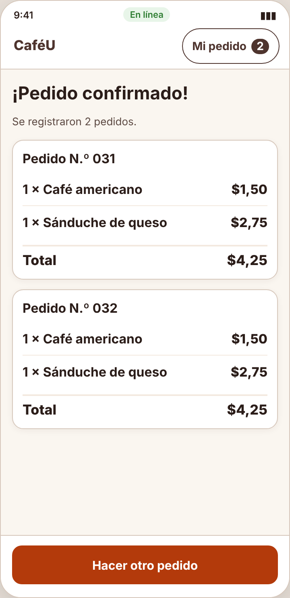
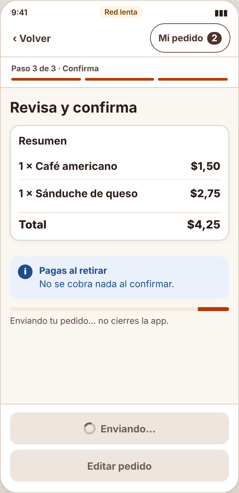
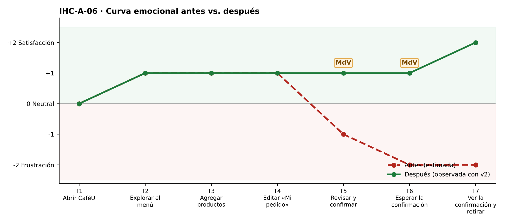

# Fase 4 · Prueba cognitiva y mejora — IHC-A-06 · CaféU · Confirmación sin duplicados con red inestable

**Moderador:** Mora Beltrán Santiago Sebastián · **Observador:** Acaro Ibujés Pedro Sebastián

| Elemento | Detalle |
|---|---|
| Participante | **PX-06** · Estudiante de otro equipo (Grupo 3); el moderador activó la red lenta (4 s). No participó en el diseño. |
| Consigna (sin ayudas) | «Confirmar pedido desde el teléfono.» |
| Condición | No se debe afirmar éxito mientras la confirmación está pendiente. |
| Prototipo | `prototipo/v1/` y luego `prototipo/v2/` (misma tarea). |
| Registro | Tiempo, errores, pausas > 3 s, resultado y cita textual. |

| Versión | Tiempo | Errores | Pausas | Resultado | Cita textual |
|---|---|---|---|---|---|
| v1 | 64 s | 1 | 1 (3 s tras el primer toque) | Pulsó dos veces; se registraron los pedidos N.º 031 y N.º 032 | «No hacía nada, por eso volví a tocar.» |
| v2 | 58 s | 0 | 1 (4 s esperando con «Enviando…») | Un solo pedido N.º 031 | «Vi que estaba enviando y esperé.» |

## Observaciones con v1
- Pulsó «Confirmar»; durante 3 s no cambió nada en el botón.
- Volvió a pulsar.
- La confirmación mostró dos pedidos registrados.

## Hallazgo corregido (Issue #6)
**Confirmaciones duplicadas por doble pulsación (Issue #6).** Cambio en v2: En `send()` el botón se deshabilita con `aria-busy` y spinner; `#confirm` ignora clics mientras `S.busy`.

| Antes (v1) | Después (v2) |
|---|---|
|  |  |
| Dos pedidos registrados por doble pulsación (v1) | Botón bloqueado «Enviando…» (v2) |

## Mejora demostrada frente a estimada
| Mejora | Tipo | Evidencia |
|---|---|---|
| Tiempo 64 s → 58 s | **Demostrada** | Misma tarea y participante, cronometrada. |
| Errores 1 → 0 | **Demostrada** | Registro de observación. |
| Resultado: «Pulsó dos veces; se registraron los pedidos N.º 031 y N.º 032» → «Un solo pedido N.º 031» | **Demostrada** | Observación y capturas. |
| Emoción en momentos de verdad: T5 −1 → +1; T6 −2 😟 → +1 | Inferida de pausas y cita | `diagramas/curva-despues.png` |
| Generalización a otros usuarios | Estimada | Una sesión; requiere más participantes. |

