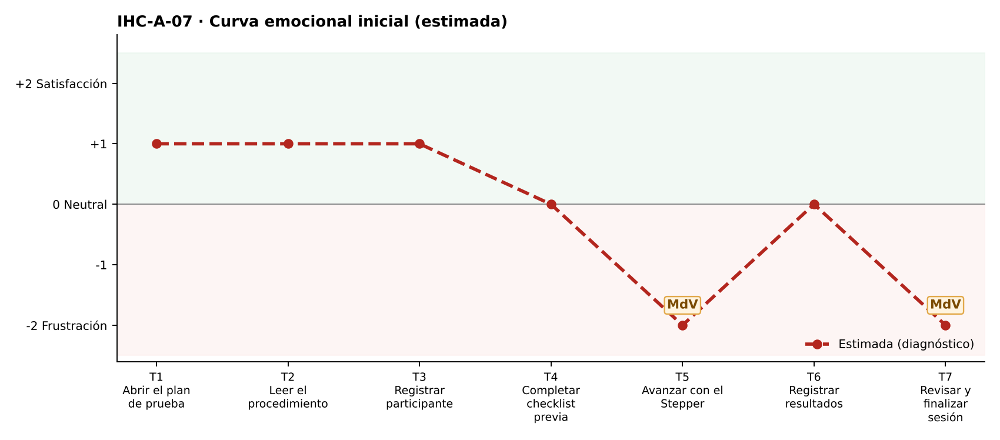

# Fase 1 · Diagnóstico emocional — IHC-A-07 · Dashboard UX · Stepper que no permite saltar etapas

**Responsable de la tarjeta:** González Álvarez Vladimir Humberto · **Revisor:** Mora Beltrán Santiago Sebastián · **Issue:** #7

## 1. Tarjeta
| Campo | Contenido |
|---|---|
| Persona usuaria | Investigadora novata que prepara una prueba |
| Tarea crítica | Configurar checklist y avanzar por etapas |
| Restricción obligatoria | Debe identificar en todo momento el paso actual |
| Fallo adicional específico | Stepper permite saltar etapas sin completar requisitos |
| Repositorio base | maribelsailema/HCI_2026_G1 (Usability Test Plan Dashboard: 7 touchpoints, 2 momentos de verdad, curva emocional, Card UI, Stepper y Grid) |
| Repositorio complementario | Sax300-cpu/HCI-2026-G2 (CaféU y su carpeta presentacion) |

## 2. Touchpoints
Siete touchpoints del recorrido de la tarea crítica sobre la interfaz de referencia. En esta fase las emociones son **estimadas**; las observadas están en `pruebas/sesion.md`.

| N.º | Touchpoint | Qué ocurre | Emoción estimada | Tipo | Momento de verdad |
|---|---|---|---|---|---|
| T1 | Abrir el plan de prueba | Abre el plan. | +1 | Estimado | — |
| T2 | Leer el procedimiento | Lee «Cómo funciona esta sesión». | +1 | Estimado | — |
| T3 | Registrar participante | Escribe el código del participante. | +1 | Estimado | — |
| T4 | Completar checklist previa | Marca la checklist. | 0 😐 | Estimado | — |
| T5 | Avanzar con el Stepper | Avanza con el Stepper. | −2 😟 | Estimado | **Sí** |
| T6 | Registrar resultados | Registra resultados. | 0 😐 | Estimado | — |
| T7 | Revisar y finalizar sesión | Revisa y finaliza. | −2 😟 | Estimado | **Sí** |

## 3. Momentos de verdad
1. **T5 · Avanzar con el Stepper.** «Avanzar con el Stepper»: puede saltar al paso 5 sin checklist.
2. **T7 · Revisar y finalizar sesión.** «Revisar y finalizar»: descubre tarde que faltan requisitos.

## 4. Curva emocional inicial

## 5. Fallos priorizados
Prioridad = severidad de Nielsen × frecuencia esperada.

| N.º | Fallo | Heurística de Nielsen | Gestalt / carga cognitiva | Severidad | Frecuencia | Prioridad | Decisión | Seguimiento |
|---|---|---|---|---|---|---|---|---|
| 1 | El Stepper permite saltar a etapas futuras sin requisitos | N5 Prevención de errores; N1 | Carga cognitiva: recordar qué falta | 4 · Catastrófico | Alta | P1 | Bloquear etapas futuras hasta completar la actual (v2). | Issue #7 |
| 2 | El paso actual no se identifica fuera del color | N1; WCAG 1.4.1 | Gestalt: semejanza entre pasos | 3 · Grave | Media | P2 | Texto «Paso n de 5 · Nombre» siempre visible. | Tarea de la issue #7 |
| 3 | No se explica por qué no se puede avanzar | N9 Reconocer y recuperarse | — | 3 · Grave | Media | P3 | Mensaje con la lista de requisitos faltantes. | Tarea de la issue #7 |

## 6. Estimación frente a observación
| Afirmación | Tipo | Cómo se comprueba |
|---|---|---|
| «El Stepper permite saltar a etapas futuras sin requisitos» afecta la tarea crítica. | Estimación | Prueba cognitiva con v1 (tiempo, errores, pausas, cita). |
| Los momentos de verdad son T5 y T7. | Estimación | Pausas y comentarios de la prueba. |
| La curva mejora tras la corrección. | Estimación | Misma tarea con v2 (`curva-despues.png`). |

## 7. Principio del repositorio complementario
Rama «confirmar o editar» de CaféU: «Revisión y cierre» con enlaces «Editar» por etapa antes de finalizar.
