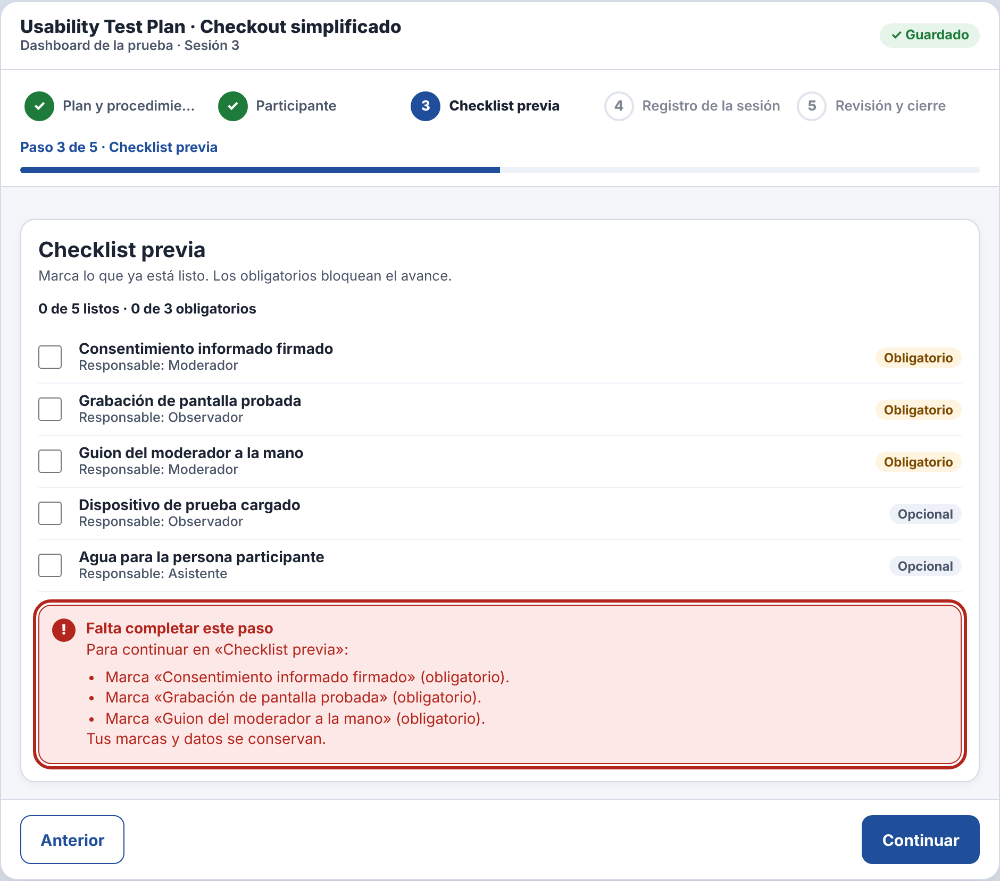

# Incidencia — IHC-A-07 · Dashboard UX · Stepper que no permite saltar etapas

| Campo | Detalle |
|---|---|
| Incidencia (minuto 100) | Bloquear avances inválidos con explicación y permitir volver sin perder marcas |
| Responsable / revisor | González Álvarez Vladimir Humberto / Mora Beltrán Santiago Sebastián |
| Requisito nuevo | **RF-07** — Ante un avance inválido (Continuar o clic en un paso bloqueado), explicar qué falta con una lista enfocable, sin borrar marcas. |
| Criterio | Al pulsar el paso 5 desde el 3 aparece «No puedes ir a…» con los obligatorios faltantes. |
| Flujo | `diagramas/user-flow.png` (nodos en naranja) |
| Cambio en el prototipo | `tryGo()` y «Continuar» llaman a `explain()`, que muestra la lista de faltantes con `role="alert"` y foco; las marcas se conservan al volver. |
| Prueba | Leyó la lista de faltantes, marcó los obligatorios y avanzó — 102 s, 0 errores. Cita: «Me dice exactamente qué falta.» |
| Commit | Rama `fix/vladimir-incidencias-07-09`, posterior a la entrega, con «Closes #» de la issue de la incidencia |

| Antes (v2) | Después (v2 con incidencia) |
|---|---|
|  |  |
