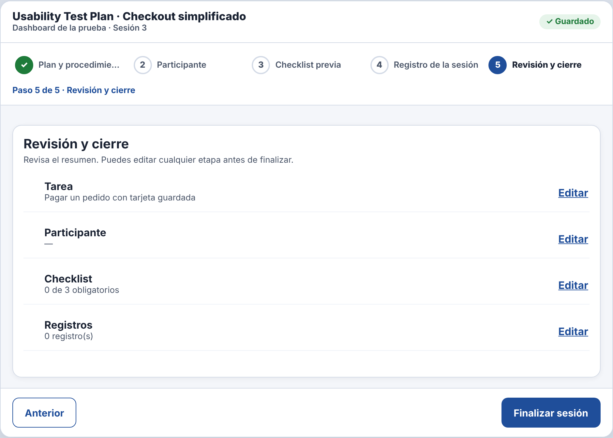
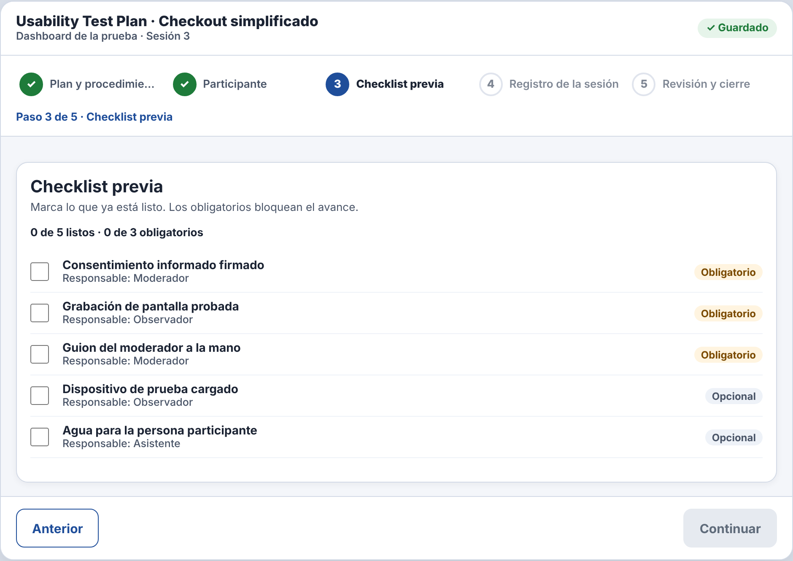
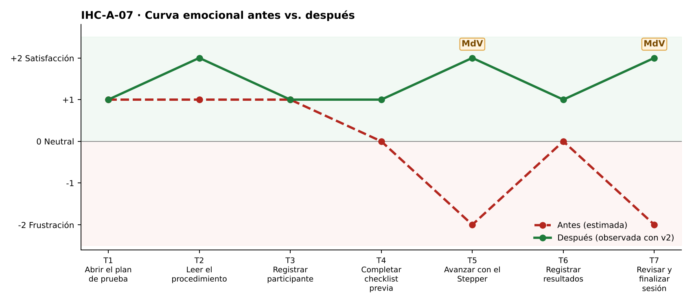

# Fase 4 · Prueba cognitiva y mejora — IHC-A-07 · Dashboard UX · Stepper que no permite saltar etapas

**Moderador:** González Álvarez Vladimir Humberto · **Observador:** Mora Beltrán Santiago Sebastián

| Elemento | Detalle |
|---|---|
| Participante | **PX-07** · Estudiante de otro equipo (Grupo 2) en el rol de investigadora novata. No participó en el diseño. |
| Consigna (sin ayudas) | «Configurar checklist y avanzar por etapas.» |
| Condición | Debe identificar en todo momento el paso actual. |
| Prototipo | `prototipo/v1/` y luego `prototipo/v2/` (misma tarea). |
| Registro | Tiempo, errores, pausas > 3 s, resultado y cita textual. |

| Versión | Tiempo | Errores | Pausas | Resultado | Cita textual |
|---|---|---|---|---|---|
| v1 | 154 s | 2 | 2 (9 s en el paso 5; 6 s buscando qué faltaba) | Saltó al paso 5 y cerró la sesión sin marcar la checklist | «Me dejó llegar al final, pensé que ya estaba.» |
| v2 | 131 s | 1 | 1 (12 s con «Continuar» deshabilitado) | No pudo saltar; tardó en entender qué faltaba | «¿Por qué no me deja seguir?» |

## Observaciones con v1
- Desde el paso 2 pulsó «Revisión y cierre» en el Stepper.
- La checklist obligatoria quedó vacía.
- Finalizó la sesión.

## Hallazgo corregido (Issue #7)
**El Stepper permite saltar etapas sin completar requisitos (Issue #7).** Cambio en v2: `canVisit()` bloquea etapas futuras (`aria-disabled`) y «Continuar» se deshabilita hasta cumplir `missing()`.

| Antes (v1) | Después (v2) |
|---|---|
|  |  |
| Salto directo a «Revisión y cierre» sin checklist (v1) | Pasos futuros bloqueados (v2) |

## Mejora demostrada frente a estimada
| Mejora | Tipo | Evidencia |
|---|---|---|
| Tiempo 154 s → 131 s | **Demostrada** | Misma tarea y participante, cronometrada. |
| Errores 2 → 1 | **Demostrada** | Registro de observación. |
| Resultado: «Saltó al paso 5 y cerró la sesión sin marcar la checklist» → «No pudo saltar; tardó en entender qué faltaba» | **Demostrada** | Observación y capturas. |
| Emoción en momentos de verdad: T5 −2 😟 → +2 😊; T7 −2 😟 → +2 😊 | Inferida de pausas y cita | `diagramas/curva-despues.png` |
| Generalización a otros usuarios | Estimada | Una sesión; requiere más participantes. |

