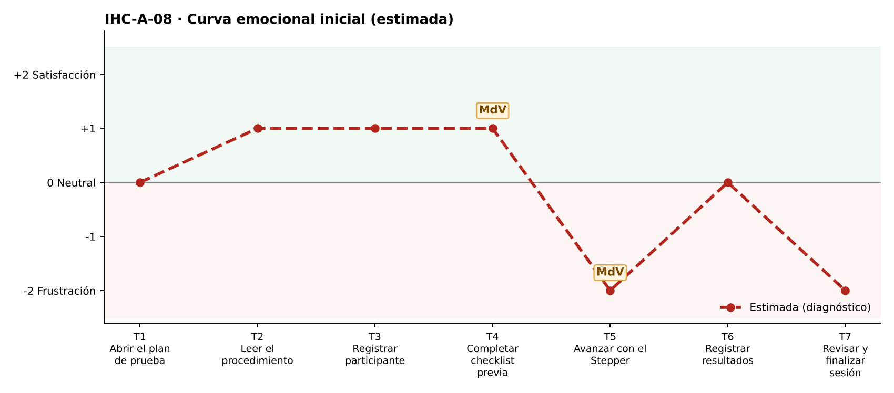

# Fase 1 · Diagnóstico emocional — IHC-A-08 · Dashboard UX · Checklist que se conserva y estado de guardado

**Responsable de la tarjeta:** González Álvarez Vladimir Humberto · **Revisor:** Mora Beltrán Santiago Sebastián · **Issue:** #8

## 1. Tarjeta
| Campo | Contenido |
|---|---|
| Persona usuaria | Docente evaluador que prepara sesión contrarreloj |
| Tarea crítica | Completar datos de prueba y checklist |
| Restricción obligatoria | El procedimiento debe quedar claro antes de iniciar |
| Fallo adicional específico | Las casillas parecen guardadas pero se pierden al cambiar de paso |
| Repositorio base | maribelsailema/HCI_2026_G1 (Usability Test Plan Dashboard: 7 touchpoints, 2 momentos de verdad, curva emocional, Card UI, Stepper y Grid) |
| Repositorio complementario | Sax300-cpu/HCI-2026-G2 (CaféU y su carpeta presentacion) |

## 2. Touchpoints
Siete touchpoints del recorrido de la tarea crítica sobre la interfaz de referencia. En esta fase las emociones son **estimadas**; las observadas están en `pruebas/sesion.md`.

| N.º | Touchpoint | Qué ocurre | Emoción estimada | Tipo | Momento de verdad |
|---|---|---|---|---|---|
| T1 | Abrir el plan de prueba | Abre el plan con poco tiempo. | 0 😐 | Estimado | — |
| T2 | Leer el procedimiento | Lee el procedimiento. | +1 | Estimado | — |
| T3 | Registrar participante | Registra el código. | +1 | Estimado | — |
| T4 | Completar checklist previa | Marca la checklist; ve «Guardado». | +1 | Estimado | **Sí** |
| T5 | Avanzar con el Stepper | Avanza y regresa. | −2 😟 | Estimado | **Sí** |
| T6 | Registrar resultados | Registra resultados. | 0 😐 | Estimado | — |
| T7 | Revisar y finalizar sesión | Finaliza. | −2 😟 | Estimado | — |

## 3. Momentos de verdad
1. **T4 · Completar checklist previa.** «Completar checklist»: el aviso «Guardado» da falsa seguridad.
2. **T5 · Avanzar con el Stepper.** «Avanzar con el Stepper»: al volver, las marcas desaparecieron.

## 4. Curva emocional inicial

## 5. Fallos priorizados
Prioridad = severidad de Nielsen × frecuencia esperada.

| N.º | Fallo | Heurística de Nielsen | Gestalt / carga cognitiva | Severidad | Frecuencia | Prioridad | Decisión | Seguimiento |
|---|---|---|---|---|---|---|---|---|
| 1 | Las marcas de la checklist se pierden al cambiar de paso | N1; N5; N3 | Carga cognitiva: volver a marcar todo | 4 · Catastrófico | Alta | P1 | Conservar el estado al cambiar de paso (v2). | Issue #8 |
| 2 | «Guardado» aparece aunque no se guarde | N1 Visibilidad del estado (estado falso) | — | 4 · Catastrófico | Media | P2 | Mostrar «Guardando…» / «Guardado · hora» / «Sin cambios» reales. | Tarea de la issue #8 |
| 3 | El procedimiento no está claro antes de iniciar | N10 Ayuda; N6 | Gestalt: región común para el procedimiento | 2 · Menor | Media | P3 | Card «Cómo funciona esta sesión» en el paso 1. | Tarea de la issue #8 |

## 6. Estimación frente a observación
| Afirmación | Tipo | Cómo se comprueba |
|---|---|---|
| «Las marcas de la checklist se pierden al cambiar de paso» afecta la tarea crítica. | Estimación | Prueba cognitiva con v1 (tiempo, errores, pausas, cita). |
| Los momentos de verdad son T4 y T5. | Estimación | Pausas y comentarios de la prueba. |
| La curva mejora tras la corrección. | Estimación | Misma tarea con v2 (`curva-despues.png`). |

## 7. Principio del repositorio complementario
Confirmación visible de CaféU: el estado guardado se confirma con evidencia (hora), no con un mensaje genérico.
