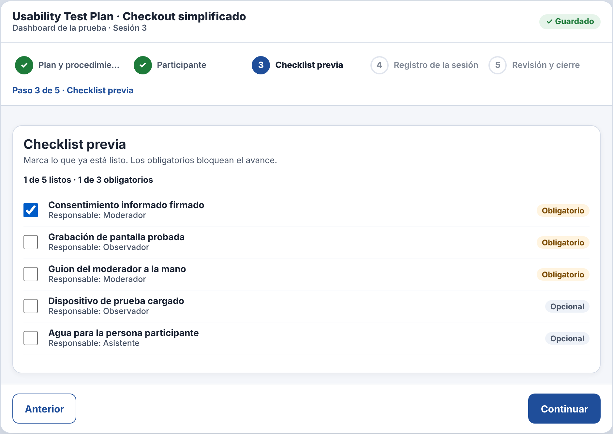
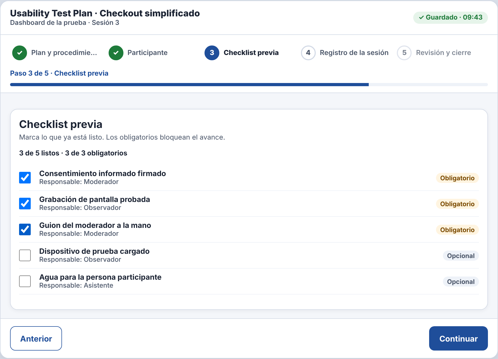

# Incidencia — IHC-A-08 · Dashboard UX · Checklist que se conserva y estado de guardado

| Campo | Detalle |
|---|---|
| Incidencia (minuto 100) | Preservar checklist, diferenciar guardado de no guardado y mostrar progreso |
| Responsable / revisor | González Álvarez Vladimir Humberto / Mora Beltrán Santiago Sebastián |
| Requisito nuevo | **RF-07** — Diferenciar «Guardando…», «✓ Guardado · hora» y «Sin cambios» en la cabecera y mostrar la barra de progreso general. |
| Criterio | Al marcar, la cabecera pasa por «Guardando…» y luego «✓ Guardado · 09:43». |
| Flujo | `diagramas/user-flow.png` (nodos en naranja) |
| Cambio en el prototipo | `markSaved()` muestra «Guardando…» y, al terminar, «✓ Guardado · hora»; la barra `#pbar` refleja el avance general. |
| Prueba | Vio «Guardando…» y «Guardado · hora» y la barra de progreso — 91 s, 0 errores. Cita: «Sé cuándo ya se guardó.» |
| Commit | Rama `fix/vladimir-incidencias-07-09`, posterior a la entrega, con «Closes #» de la issue de la incidencia |

| Antes (v2) | Después (v2 con incidencia) |
|---|---|
|  |  |
