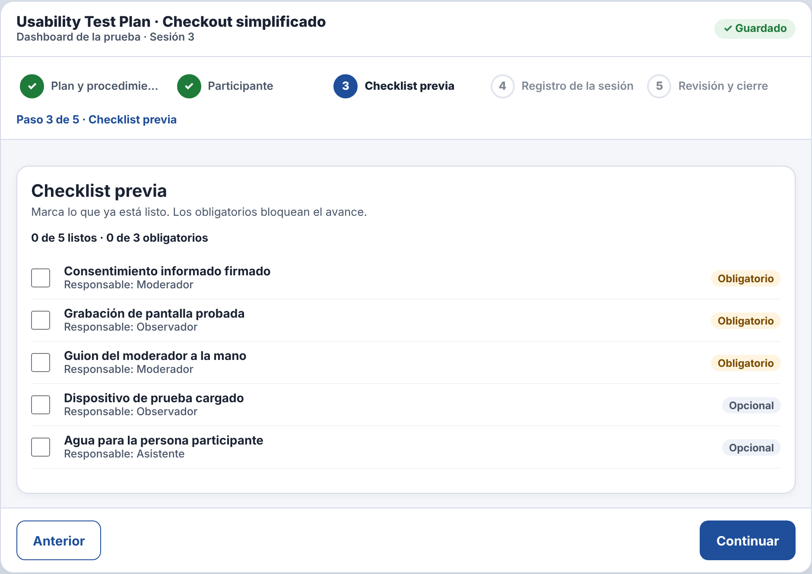
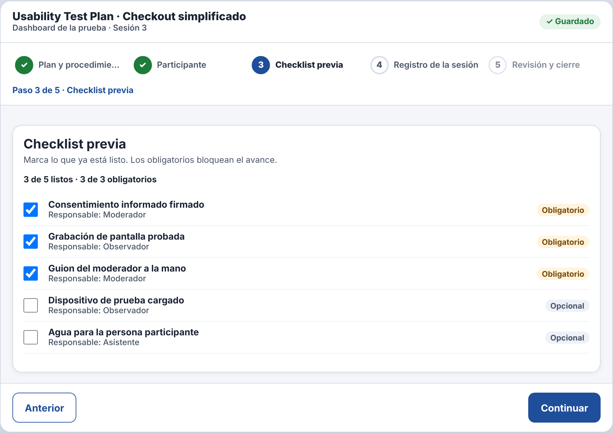
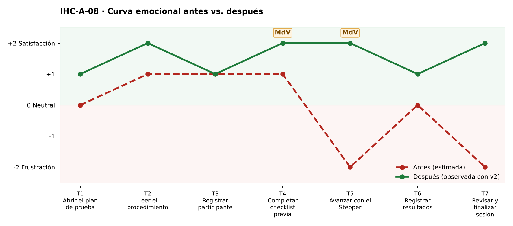

# Fase 4 · Prueba cognitiva y mejora — IHC-A-08 · Dashboard UX · Checklist que se conserva y estado de guardado

**Moderador:** González Álvarez Vladimir Humberto · **Observador:** Mora Beltrán Santiago Sebastián

| Elemento | Detalle |
|---|---|
| Participante | **PX-08** · Estudiante de otro equipo (Grupo 2) en el rol de docente evaluador con 3 minutos. No participó en el diseño. |
| Consigna (sin ayudas) | «Completar datos de prueba y checklist.» |
| Condición | El procedimiento debe quedar claro antes de iniciar. |
| Prototipo | `prototipo/v1/` y luego `prototipo/v2/` (misma tarea). |
| Registro | Tiempo, errores, pausas > 3 s, resultado y cita textual. |

| Versión | Tiempo | Errores | Pausas | Resultado | Cita textual |
|---|---|---|---|---|---|
| v1 | 166 s | 2 | 2 (10 s al ver la checklist vacía; 6 s en el cierre) | No pudo finalizar: las marcas se borraron al volver | «Decía guardado y se borró todo.» |
| v2 | 97 s | 0 | 0 | Las marcas se conservaron; finalizó | «Ahora sí siguen marcadas.» |
| v2 con incidencia | 91 s | 0 | 0 | Vio «Guardando…» y «Guardado · hora» y la barra de progreso | «Sé cuándo ya se guardó.» |

## Observaciones con v1
- Marcó 3 casillas; apareció «✓ Guardado».
- Avanzó al paso 4 y volvió al 3: casillas vacías.
- El cierre se bloqueó por checklist incompleta.

## Hallazgo corregido (Issue #8)
**Las marcas parecen guardadas pero se pierden (Issue #8).** Cambio en v2: `go()` ya no reinicia `S.checks`; el render de la etapa 3 lee el estado guardado.

| Antes (v1) | Después (v2) |
|---|---|
|  |  |
| Checklist vacía al volver al paso 3 (v1) | Marcas conservadas (v2) |

## Mejora demostrada frente a estimada
| Mejora | Tipo | Evidencia |
|---|---|---|
| Tiempo 166 s → 97 s | **Demostrada** | Misma tarea y participante, cronometrada. |
| Errores 2 → 0 | **Demostrada** | Registro de observación. |
| Resultado: «No pudo finalizar: las marcas se borraron al volver» → «Las marcas se conservaron; finalizó» | **Demostrada** | Observación y capturas. |
| Emoción en momentos de verdad: T4 +1 → +2 😊; T5 −2 😟 → +2 😊 | Inferida de pausas y cita | `diagramas/curva-despues.png` |
| Generalización a otros usuarios | Estimada | Una sesión; requiere más participantes. |

## Prueba de la incidencia
«Preservar checklist, diferenciar guardado de no guardado y mostrar progreso» — Vio «Guardando…» y «Guardado · hora» y la barra de progreso (91 s, 0 errores). Cita: «Sé cuándo ya se guardó.» Evidencia: `evidencias/incidencia/`.
