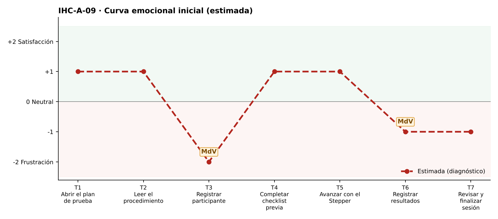

# Fase 1 · Diagnóstico emocional — IHC-A-09 · Dashboard UX · Participantes anónimos con código seudónimo

**Responsable de la tarjeta:** González Álvarez Vladimir Humberto · **Revisor:** Mora Beltrán Santiago Sebastián · **Issue:** #9

## 1. Tarjeta
| Campo | Contenido |
|---|---|
| Persona usuaria | Investigadora que trabaja con participantes anónimos |
| Tarea crítica | Registrar resultados y finalizar sesión |
| Restricción obligatoria | No mostrar nombres reales en evidencias |
| Fallo adicional específico | Un formulario exige nombre real y no admite código de participante |
| Repositorio base | maribelsailema/HCI_2026_G1 (Usability Test Plan Dashboard: 7 touchpoints, 2 momentos de verdad, curva emocional, Card UI, Stepper y Grid) |
| Repositorio complementario | Sax300-cpu/HCI-2026-G2 (CaféU y su carpeta presentacion) |

## 2. Touchpoints
Siete touchpoints del recorrido de la tarea crítica sobre la interfaz de referencia. En esta fase las emociones son **estimadas**; las observadas están en `pruebas/sesion.md`.

| N.º | Touchpoint | Qué ocurre | Emoción estimada | Tipo | Momento de verdad |
|---|---|---|---|---|---|
| T1 | Abrir el plan de prueba | Abre el plan. | +1 | Estimado | — |
| T2 | Leer el procedimiento | Lee el procedimiento. | +1 | Estimado | — |
| T3 | Registrar participante | Registra al participante. | −2 😟 | Estimado | **Sí** |
| T4 | Completar checklist previa | Marca la checklist. | +1 | Estimado | — |
| T5 | Avanzar con el Stepper | Avanza. | +1 | Estimado | — |
| T6 | Registrar resultados | Registra resultados (tabla). | −1 | Estimado | **Sí** |
| T7 | Revisar y finalizar sesión | Revisa y finaliza. | −1 | Estimado | — |

## 3. Momentos de verdad
1. **T3 · Registrar participante.** «Registrar participante»: el formulario exige el nombre real.
2. **T6 · Registrar resultados.** «Registrar resultados»: el nombre aparece en la tabla de evidencias.

## 4. Curva emocional inicial

## 5. Fallos priorizados
Prioridad = severidad de Nielsen × frecuencia esperada.

| N.º | Fallo | Heurística de Nielsen | Gestalt / carga cognitiva | Severidad | Frecuencia | Prioridad | Decisión | Seguimiento |
|---|---|---|---|---|---|---|---|---|
| 1 | El formulario exige nombre real y no admite código | N2; N5; privacidad | — | 4 · Catastrófico | Alta | P1 | Campo «Código de participante» en lugar del nombre (v2). | Issue #9 |
| 2 | El nombre aparece en tablas y resumen | N5 Prevención de errores | Gestalt: proximidad — dato sensible junto a resultados | 4 · Catastrófico | Media | P2 | Mostrar solo el código en evidencias. | Tarea de la issue #9 |
| 3 | No se indica el formato esperado del código | N6; N9 | Carga cognitiva: inventar formato | 2 · Menor | Media | P3 | Pista «Ejemplo: P-07». | Tarea de la issue #9 |

## 6. Estimación frente a observación
| Afirmación | Tipo | Cómo se comprueba |
|---|---|---|
| «El formulario exige nombre real y no admite código» afecta la tarea crítica. | Estimación | Prueba cognitiva con v1 (tiempo, errores, pausas, cita). |
| Los momentos de verdad son T3 y T6. | Estimación | Pausas y comentarios de la prueba. |
| La curva mejora tras la corrección. | Estimación | Misma tarea con v2 (`curva-despues.png`). |

## 7. Principio del repositorio complementario
Rama de error de CaféU: mensaje junto al campo con salida clara y conservación de datos.
