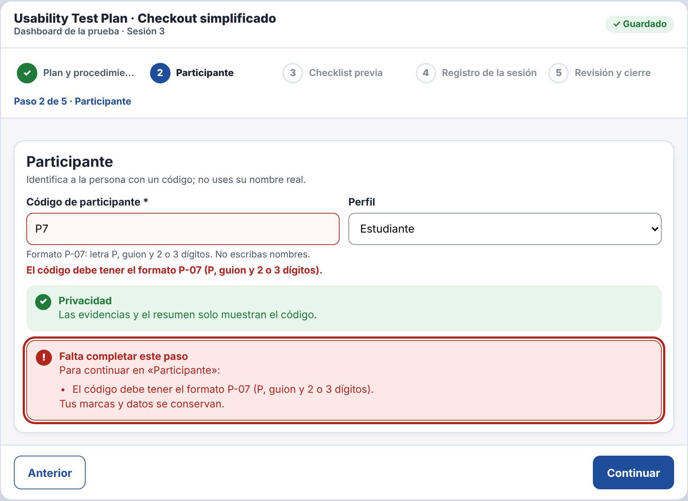

# Incidencia — IHC-A-09 · Dashboard UX · Participantes anónimos con código seudónimo

| Campo | Detalle |
|---|---|
| Incidencia (minuto 100) | Sustituir por código seudónimo y validar su formato |
| Responsable / revisor | González Álvarez Vladimir Humberto / Mora Beltrán Santiago Sebastián |
| Requisito nuevo | **RF-07** — Validar el formato del código seudónimo (P-07: P, guion y 2–3 dígitos) al salir del campo y al continuar, con mensaje junto al campo. |
| Criterio | «ana» muestra «El código debe tener el formato P-07…». |
| Flujo | `diagramas/user-flow.png` (nodos en naranja) |
| Cambio en el prototipo | `missing(1)` valida `/^P-\d{2,3}$/`; `fieldErr()` muestra el error junto al campo con `aria-invalid` y `aria-describedby`. |
| Prueba | Escribió «p7»; el mensaje indicó el formato y corrigió a P-07 — 94 s, 1 errores. Cita: «Me dijo el formato, listo.» |
| Commit | Rama `fix/vladimir-incidencias-07-09`, posterior a la entrega, con «Closes #» de la issue de la incidencia |

| Antes (v2) | Después (v2 con incidencia) |
|---|---|
|  |  |
