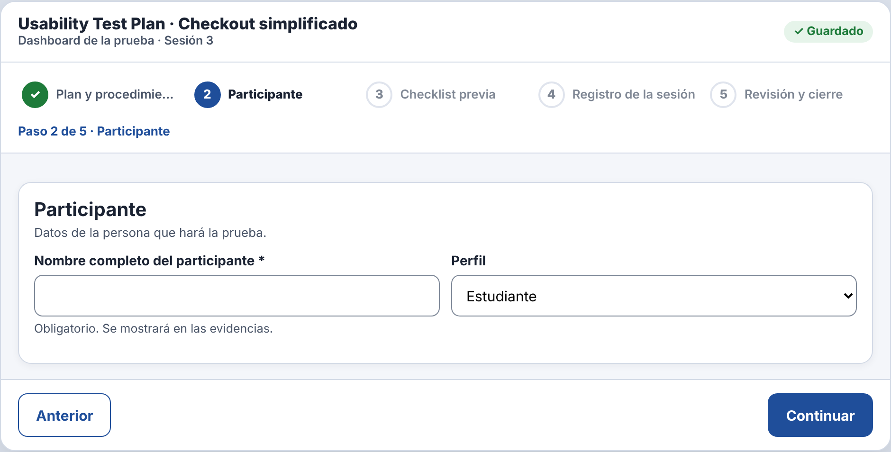
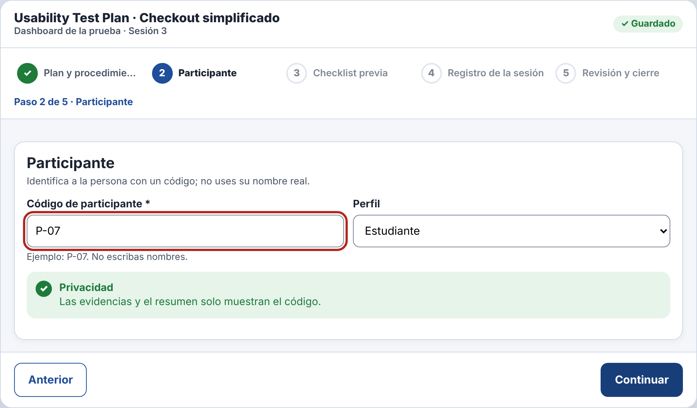
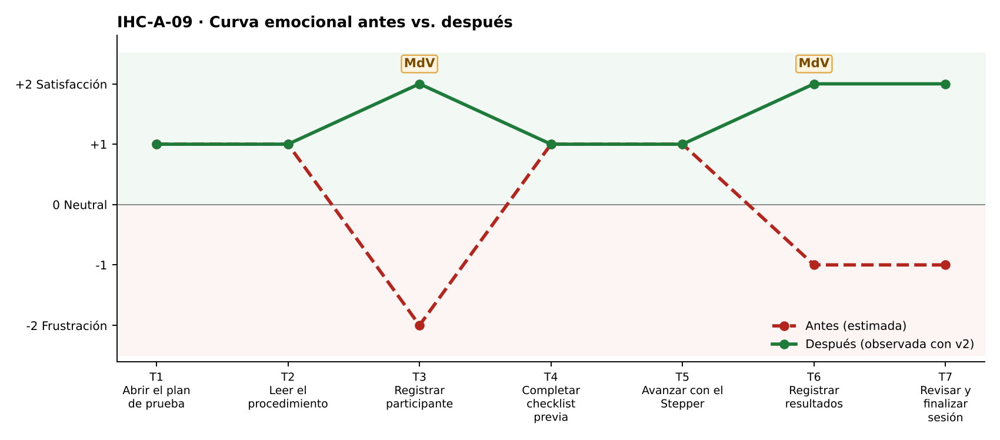

# Fase 4 · Prueba cognitiva y mejora — IHC-A-09 · Dashboard UX · Participantes anónimos con código seudónimo

**Moderador:** González Álvarez Vladimir Humberto · **Observador:** Mora Beltrán Santiago Sebastián

| Elemento | Detalle |
|---|---|
| Participante | **PX-09** · Estudiante de otro equipo (Grupo 2) en el rol de investigadora. No participó en el diseño. |
| Consigna (sin ayudas) | «Registrar resultados y finalizar sesión.» |
| Condición | No mostrar nombres reales en evidencias. |
| Prototipo | `prototipo/v1/` y luego `prototipo/v2/` (misma tarea). |
| Registro | Tiempo, errores, pausas > 3 s, resultado y cita textual. |

| Versión | Tiempo | Errores | Pausas | Resultado | Cita textual |
|---|---|---|---|---|---|
| v1 | 139 s | 2 | 2 (11 s ante «Nombre completo»; 5 s en la tabla) | Escribió un nombre inventado para poder avanzar; el nombre quedó en la tabla | «No puedo poner el nombre real, pero no me deja seguir sin nombre.» |
| v2 | 88 s | 0 | 0 | Usó el código P-07; la tabla muestra solo el código | «Con el código está bien.» |
| v2 con incidencia | 94 s | 1 | 1 (lectura del error) | Escribió «p7»; el mensaje indicó el formato y corrigió a P-07 | «Me dijo el formato, listo.» |

## Observaciones con v1
- El paso 2 exigía «Nombre completo».
- Escribió un nombre inventado.
- El nombre apareció en la tabla de registros.

## Hallazgo corregido (Issue #9)
**Formulario que exige nombre real (Issue #9).** Cambio en v2: `step1()` reemplaza el nombre por «Código de participante»; `rowsTable()` y el resumen muestran solo el código.

| Antes (v1) | Después (v2) |
|---|---|
|  |  |
| Campo «Nombre completo» obligatorio (v1) | «Código de participante» (v2) |

## Mejora demostrada frente a estimada
| Mejora | Tipo | Evidencia |
|---|---|---|
| Tiempo 139 s → 88 s | **Demostrada** | Misma tarea y participante, cronometrada. |
| Errores 2 → 0 | **Demostrada** | Registro de observación. |
| Resultado: «Escribió un nombre inventado para poder avanzar; el nombre quedó en la tabla» → «Usó el código P-07; la tabla muestra solo el código» | **Demostrada** | Observación y capturas. |
| Emoción en momentos de verdad: T3 −2 😟 → +2 😊; T6 −1 → +2 😊 | Inferida de pausas y cita | `diagramas/curva-despues.png` |
| Generalización a otros usuarios | Estimada | Una sesión; requiere más participantes. |

## Prueba de la incidencia
«Sustituir por código seudónimo y validar su formato» — Escribió «p7»; el mensaje indicó el formato y corrigió a P-07 (94 s, 1 errores). Cita: «Me dijo el formato, listo.» Evidencia: `evidencias/incidencia/`.
