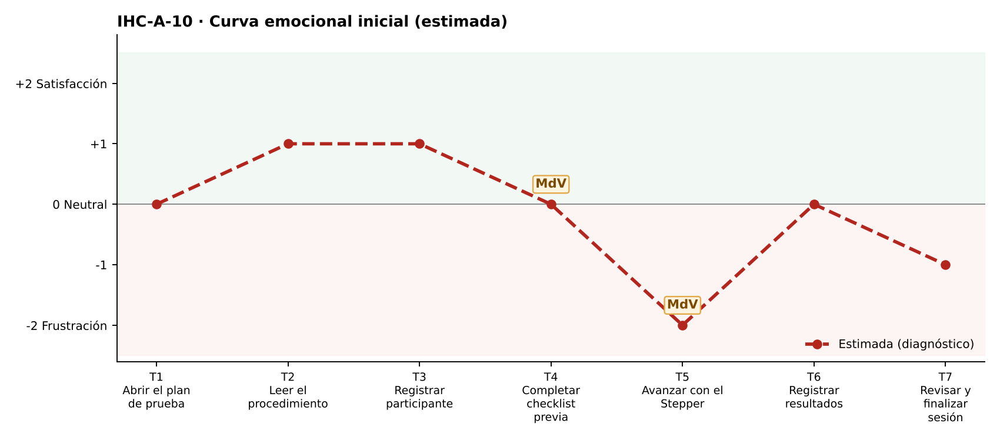

# Fase 1 · Diagnóstico emocional — IHC-A-10 · Dashboard UX · Stepper y checklist con lector de pantalla

**Responsable de la tarjeta:** Vinces Cueva Boris Yussef · **Revisor:** González Álvarez Vladimir Humberto · **Issue:** #10

## 1. Tarjeta
| Campo | Contenido |
|---|---|
| Persona usuaria | Evaluador que utiliza lector de pantalla |
| Tarea crítica | Navegar Stepper y checklist |
| Restricción obligatoria | Toda acción y resultado debe estar anunciado semánticamente |
| Fallo adicional específico | El paso activo depende solo de color |
| Repositorio base | maribelsailema/HCI_2026_G1 (Usability Test Plan Dashboard: 7 touchpoints, 2 momentos de verdad, curva emocional, Card UI, Stepper y Grid) |
| Repositorio complementario | Sax300-cpu/HCI-2026-G2 (CaféU y su carpeta presentacion) |

## 2. Touchpoints
Siete touchpoints del recorrido de la tarea crítica sobre la interfaz de referencia. En esta fase las emociones son **estimadas**; las observadas están en `pruebas/sesion.md`.

| N.º | Touchpoint | Qué ocurre | Emoción estimada | Tipo | Momento de verdad |
|---|---|---|---|---|---|
| T1 | Abrir el plan de prueba | Abre el plan con lector. | 0 😐 | Estimado | — |
| T2 | Leer el procedimiento | Escucha el procedimiento. | +1 | Estimado | — |
| T3 | Registrar participante | Registra el código. | +1 | Estimado | — |
| T4 | Completar checklist previa | Recorre la checklist. | 0 😐 | Estimado | **Sí** |
| T5 | Avanzar con el Stepper | Cambia de paso. | −2 😟 | Estimado | **Sí** |
| T6 | Registrar resultados | Registra resultados. | 0 😐 | Estimado | — |
| T7 | Revisar y finalizar sesión | Finaliza. | −1 | Estimado | — |

## 3. Momentos de verdad
1. **T5 · Avanzar con el Stepper.** «Avanzar con el Stepper»: el lector no dice en qué paso está.
2. **T4 · Completar checklist previa.** «Completar checklist»: no sabe cuántos obligatorios faltan.

## 4. Curva emocional inicial

## 5. Fallos priorizados
Prioridad = severidad de Nielsen × frecuencia esperada.

| N.º | Fallo | Heurística de Nielsen | Gestalt / carga cognitiva | Severidad | Frecuencia | Prioridad | Decisión | Seguimiento |
|---|---|---|---|---|---|---|---|---|
| 1 | El paso activo solo se distingue por color | WCAG 1.4.1; N1 | Gestalt: semejanza — todos los pasos iguales sin color | 4 · Catastrófico | Alta | P1 | Texto «Paso n de 5 · Nombre», ✓ en completados (v2). | Issue #10 |
| 2 | Los cambios de paso no se anuncian | WCAG 4.1.3; N1 | — | 3 · Grave | Media | P2 | Región aria-live y foco al título. | Tarea de la issue #10 |
| 3 | Foco poco visible (contorno punteado tenue) | WCAG 2.4.7 | — | 3 · Grave | Media | P3 | Anillo de foco de 3 px de alto contraste. | Tarea de la issue #10 |

## 6. Estimación frente a observación
| Afirmación | Tipo | Cómo se comprueba |
|---|---|---|
| «El paso activo solo se distingue por color» afecta la tarea crítica. | Estimación | Prueba cognitiva con v1 (tiempo, errores, pausas, cita). |
| Los momentos de verdad son T5 y T4. | Estimación | Pausas y comentarios de la prueba. |
| La curva mejora tras la corrección. | Estimación | Misma tarea con v2 (`curva-despues.png`). |

## 7. Principio del repositorio complementario
Confirmación visible de CaféU: cada acción tiene una respuesta perceptible (texto y anuncio).
