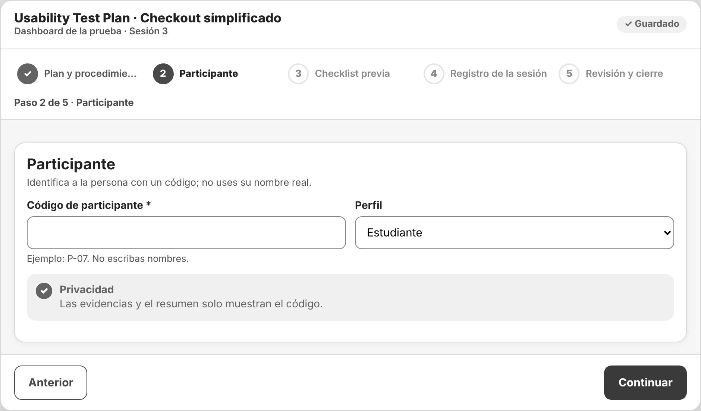
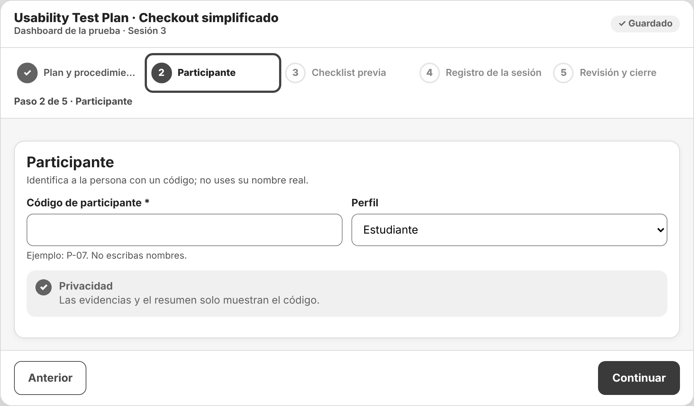

# Incidencia sorpresa — IHC-A-10 · Dashboard UX · Stepper y checklist con lector de pantalla

## Stepper sin color
| Campo | Detalle |
|---|---|
| Evento imprevisto | El docente activa una visualización en escala de grises y elimina el color del estado activo. |
| Cambio obligatorio | Identificar estado por texto y atributos semánticos; demostrar operación por teclado. |
| Evidencias pedidas | Captura en grises, foco, narración del estado, commit. |
| Responsable / revisor | Vinces Cueva Boris Yussef / González Álvarez Vladimir Humberto |
| Issue | «IHC-A-10 · Incidencia: Stepper sin color» (hora del anuncio y SHA del commit registrados en la issue y en el PR) |

## Respuesta
| Evidencia | Dónde está |
|---|---|
| Requisito nuevo **RF-07** | Paso activo con `aria-current="step"`, anuncio «Paso n de 5: Nombre» en cada cambio y foco visible de 3 px. — `docs/requisitos.md`, `docs/trazabilidad.md` |
| Flujo / wireframe actualizados | `diagramas/user-flow.png` (nodos en naranja) y `wireframes/wf-05-incidencia.png` |
| Cambio visible en el prototipo | `aria-current="step"`, `live()` anuncia «Paso n de 5: Nombre» en `go()`, foco al título y anillo de foco de 3 px. — `prototipo/v2/index.html` |
| Prueba funcional | En escala de grises identificó el paso por texto y NVDA anunció «paso actual»; recorrió todo con teclado (101 s, 0 errores). Cita: «Sin colores igual sé que estoy en el paso 2.» — `pruebas/sesion.md` |
| Antes / después | `evidencias/incidencia/` |
| Evidencia específica | Captura en escala de grises: `evidencias/incidencia/` (abrir el prototipo con `?gris=1`). |
| Commit y revisión | Rama de incidencias de Boris, commit posterior al anuncio, PR revisado por Vladimir |
| Defensa | Demuestre cómo conoce el paso actual sin depender del color. — `docs/defensa.md` |

## Verificación (rúbrica de la incidencia, 0,25)
| Criterio | Cumplimiento |
|---|---|
| Funcionamiento comprobable (0,08) | NVDA lee «Participante, paso actual»; el anillo de foco es visible. |
| Requisito, flujo o wireframe actualizado (0,05) | RF-07, user flow y `wf-05-incidencia.png` |
| Prueba y evidencia antes/después (0,05) | `pruebas/sesion.md` y `evidencias/incidencia/` |
| Commit posterior y revisión de compañero (0,04) | PR de incidencias revisado por González Álvarez Vladimir Humberto |
| Defensa individual (0,03) | `docs/defensa.md` |

| Antes (v2) | Después (v2 con la incidencia) |
|---|---|
|  |  |
