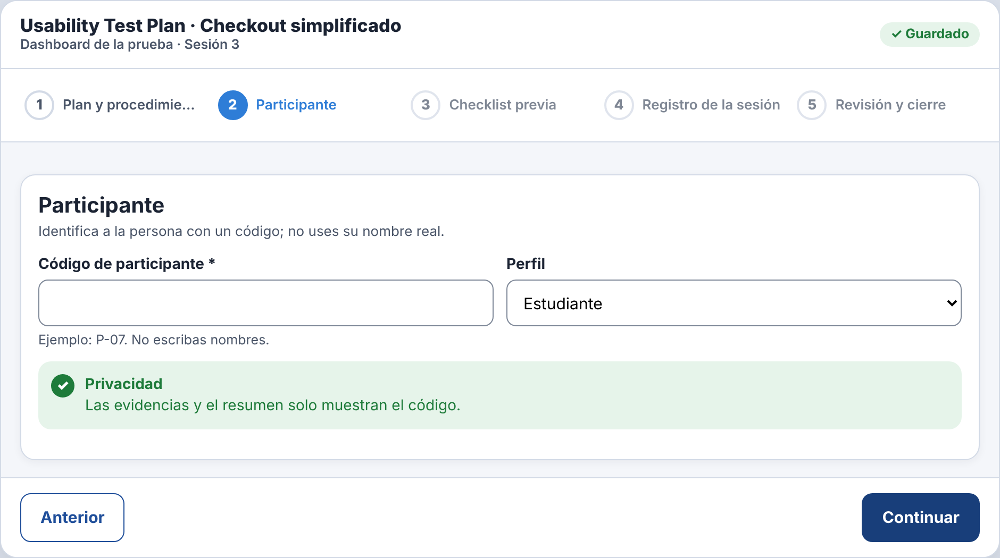
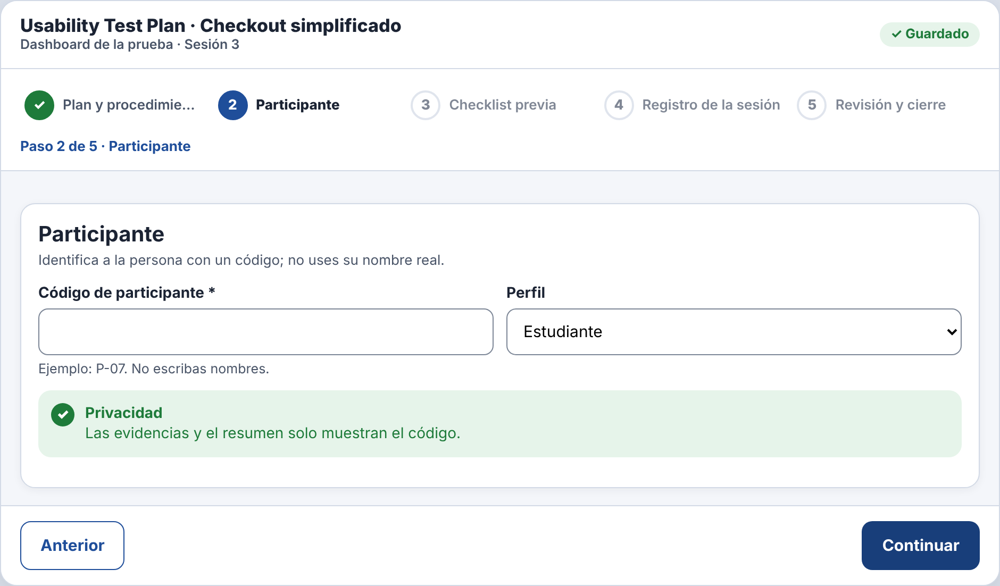
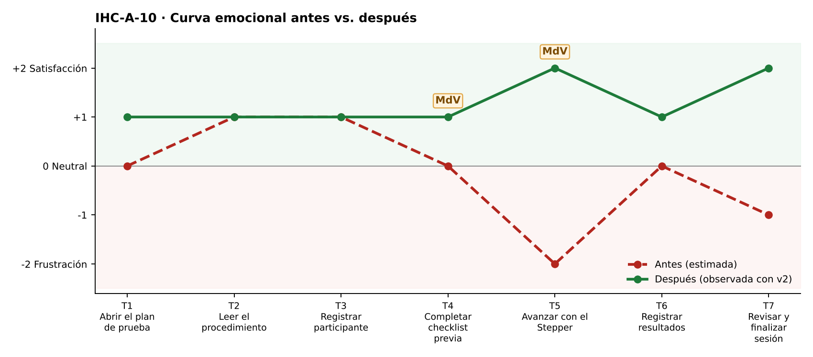

# Fase 4 · Prueba cognitiva y mejora — IHC-A-10 · Dashboard UX · Stepper y checklist con lector de pantalla

**Moderador:** Vinces Cueva Boris Yussef · **Observador:** González Álvarez Vladimir Humberto

| Elemento | Detalle |
|---|---|
| Participante | **PX-10** · Estudiante de otro equipo (Grupo 5) que usó NVDA con la pantalla apagada. No participó en el diseño. |
| Consigna (sin ayudas) | «Navegar Stepper y checklist.» |
| Condición | Toda acción y resultado debe estar anunciado semánticamente. |
| Prototipo | `prototipo/v1/` y luego `prototipo/v2/` (misma tarea). |
| Registro | Tiempo, errores, pausas > 3 s, resultado y cita textual. |

| Versión | Tiempo | Errores | Pausas | Resultado | Cita textual |
|---|---|---|---|---|---|
| v1 | 188 s | 3 | 3 (preguntó «¿dónde estoy?» tres veces) | Completó con ayuda del contexto, sin saber el paso actual | «El lector solo dice números, no sé cuál es el actual.» |
| v2 | 129 s | 1 | 1 (6 s tras cambiar de paso) | Escuchó «Paso 2 de 5 · Participante» | «Ya me dice en qué paso voy.» |
| v2 con incidencia | 101 s | 0 | 0 | En escala de grises identificó el paso por texto y NVDA anunció «paso actual»; recorrió todo con teclado | «Sin colores igual sé que estoy en el paso 2.» |

## Observaciones con v1
- El Stepper solo cambia el color del círculo activo.
- NVDA leyó «botón 2 Participante» igual que los demás.
- Preguntó tres veces en qué paso estaba.

## Hallazgo corregido (Issue #10)
**Paso activo indicado solo con color (Issue #10).** Cambio en v2: `renderStepper()` muestra «Paso n de 5 · Nombre», ✓ en completados y texto oculto «(paso actual)/(completado)».

| Antes (v1) | Después (v2) |
|---|---|
|  |  |
| Stepper con paso actual solo por color (v1) | «Paso 2 de 5 · Participante» y ✓ (v2) |

## Mejora demostrada frente a estimada
| Mejora | Tipo | Evidencia |
|---|---|---|
| Tiempo 188 s → 129 s | **Demostrada** | Misma tarea y participante, cronometrada. |
| Errores 3 → 1 | **Demostrada** | Registro de observación. |
| Resultado: «Completó con ayuda del contexto, sin saber el paso actual» → «Escuchó «Paso 2 de 5 · Participante»» | **Demostrada** | Observación y capturas. |
| Emoción en momentos de verdad: T5 −2 😟 → +2 😊; T4 0 😐 → +1 | Inferida de pausas y cita | `diagramas/curva-despues.png` |
| Generalización a otros usuarios | Estimada | Una sesión; requiere más participantes. |

## Prueba de la incidencia
«Identificar estado por texto y atributos semánticos; demostrar operación por teclado.» — En escala de grises identificó el paso por texto y NVDA anunció «paso actual»; recorrió todo con teclado (101 s, 0 errores). Cita: «Sin colores igual sé que estoy en el paso 2.» Evidencia: `evidencias/incidencia/`.
