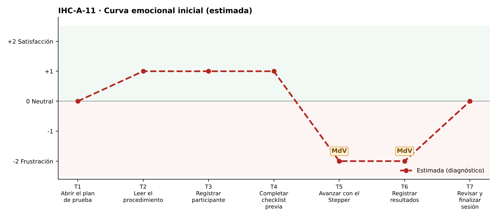

# Fase 1 · Diagnóstico emocional — IHC-A-11 · Dashboard UX · Jerarquía en 360 px sin superposiciones

**Responsable de la tarjeta:** Vinces Cueva Boris Yussef · **Revisor:** González Álvarez Vladimir Humberto · **Issue:** #11

## 1. Tarjeta
| Campo | Contenido |
|---|---|
| Persona usuaria | Evaluadora que trabaja en un monitor pequeño |
| Tarea crítica | Registrar etapa, errores y observaciones |
| Restricción obligatoria | Mantener jerarquía en un ancho de 360 px |
| Fallo adicional específico | Card UI se superpone al Stepper y oculta campos |
| Repositorio base | maribelsailema/HCI_2026_G1 (Usability Test Plan Dashboard: 7 touchpoints, 2 momentos de verdad, curva emocional, Card UI, Stepper y Grid) |
| Repositorio complementario | Sax300-cpu/HCI-2026-G2 (CaféU y su carpeta presentacion) |

## 2. Touchpoints
Siete touchpoints del recorrido de la tarea crítica sobre la interfaz de referencia. En esta fase las emociones son **estimadas**; las observadas están en `pruebas/sesion.md`.

| N.º | Touchpoint | Qué ocurre | Emoción estimada | Tipo | Momento de verdad |
|---|---|---|---|---|---|
| T1 | Abrir el plan de prueba | Abre el plan en 360 px. | 0 😐 | Estimado | — |
| T2 | Leer el procedimiento | Lee el procedimiento. | +1 | Estimado | — |
| T3 | Registrar participante | Registra el código. | +1 | Estimado | — |
| T4 | Completar checklist previa | Marca la checklist. | +1 | Estimado | — |
| T5 | Avanzar con el Stepper | Ubica el Stepper. | −2 😟 | Estimado | **Sí** |
| T6 | Registrar resultados | Registra etapa, errores y observaciones. | −2 😟 | Estimado | **Sí** |
| T7 | Revisar y finalizar sesión | Finaliza. | 0 😐 | Estimado | — |

## 3. Momentos de verdad
1. **T5 · Avanzar con el Stepper.** «Avanzar con el Stepper»: la card tapa el Stepper.
2. **T6 · Registrar resultados.** «Registrar resultados»: el campo Observaciones queda oculto.

## 4. Curva emocional inicial

## 5. Fallos priorizados
Prioridad = severidad de Nielsen × frecuencia esperada.

| N.º | Fallo | Heurística de Nielsen | Gestalt / carga cognitiva | Severidad | Frecuencia | Prioridad | Decisión | Seguimiento |
|---|---|---|---|---|---|---|---|---|
| 1 | La Card UI se superpone al Stepper y oculta campos | N8; N1 | Gestalt: región común rota — elementos encimados | 4 · Catastrófico | Alta | P1 | Eliminar el margen negativo y la altura fija (v2). | Issue #11 |
| 2 | El Stepper horizontal no cabe en 360 px | N1; N8 | Carga cognitiva: etiquetas cortadas | 3 · Grave | Media | P2 | Stepper compacto con el nombre solo del paso actual. | Tarea de la issue #11 |
| 3 | El foco visita los botones antes que los campos | WCAG 2.4.3 Orden del foco | — | 3 · Grave | Media | P3 | Orden del DOM igual al orden visual. | Tarea de la issue #11 |

## 6. Estimación frente a observación
| Afirmación | Tipo | Cómo se comprueba |
|---|---|---|
| «La Card UI se superpone al Stepper y oculta campos» afecta la tarea crítica. | Estimación | Prueba cognitiva con v1 (tiempo, errores, pausas, cita). |
| Los momentos de verdad son T5 y T6. | Estimación | Pausas y comentarios de la prueba. |
| La curva mejora tras la corrección. | Estimación | Misma tarea con v2 (`curva-despues.png`). |

## 7. Principio del repositorio complementario
User flow de CaféU: una acción principal clara al final de cada pantalla.
