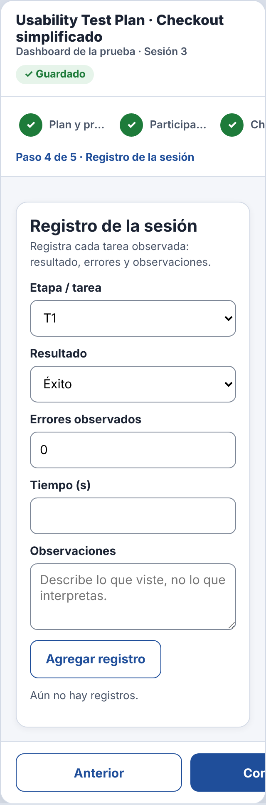
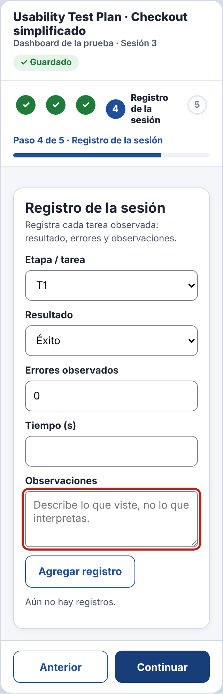

# Incidencia sorpresa — IHC-A-11 · Dashboard UX · Jerarquía en 360 px sin superposiciones

## Vista estrecha
| Campo | Detalle |
|---|---|
| Evento imprevisto | Se reduce la ventana a 320 px y el botón Siguiente queda fuera de pantalla. |
| Cambio obligatorio | Ajustar maquetación, evitar desplazamiento horizontal y conservar orden de lectura. |
| Evidencias pedidas | Capturas 320 px, checklist de accesibilidad, commit. |
| Responsable / revisor | Vinces Cueva Boris Yussef / González Álvarez Vladimir Humberto |
| Issue | «IHC-A-11 · Incidencia: Vista estrecha» (hora del anuncio y SHA del commit registrados en la issue y en el PR) |

## Respuesta
| Evidencia | Dónde está |
|---|---|
| Requisito nuevo **RF-07** | Maquetación responsiva hasta 320 px: sin desplazamiento horizontal, «Continuar» siempre visible y orden de lectura y de foco igual al visual. — `docs/requisitos.md`, `docs/trazabilidad.md` |
| Flujo / wireframe actualizados | `diagramas/user-flow.png` (nodos en naranja) y `wireframes/wf-05-incidencia.png` |
| Cambio visible en el prototipo | Clase `compact` a 320 px: una columna, Stepper compacto, acciones que se reparten el ancho (`flex:1`) y orden del DOM igual al visual; sin desplazamiento horizontal. — `prototipo/v2/index.html` |
| Prueba funcional | A 320 px vio «Continuar» completo y avanzó con teclado en orden (95 s, 0 errores). Cita: «Ya entra todo en la pantalla.» — `pruebas/sesion.md` |
| Antes / después | `evidencias/incidencia/` |
| Evidencia específica | Capturas a 320 px (`?ancho=320`) y `docs/checklist-accesibilidad.md`. |
| Commit y revisión | Rama de incidencias de Boris, commit posterior al anuncio, PR revisado por Vladimir |
| Defensa | ¿Qué ley Gestalt aplica y qué carga cognitiva se reduce? — `docs/defensa.md` |

## Verificación (rúbrica de la incidencia, 0,25)
| Criterio | Cumplimiento |
|---|---|
| Funcionamiento comprobable (0,08) | A 320 px, «Anterior» y «Continuar» se ven completos y Tab recorre campos → acciones. |
| Requisito, flujo o wireframe actualizado (0,05) | RF-07, user flow y `wf-05-incidencia.png` |
| Prueba y evidencia antes/después (0,05) | `pruebas/sesion.md` y `evidencias/incidencia/` |
| Commit posterior y revisión de compañero (0,04) | PR de incidencias revisado por González Álvarez Vladimir Humberto |
| Defensa individual (0,03) | `docs/defensa.md` |

| Antes (v2) | Después (v2 con la incidencia) |
|---|---|
|  |  |
