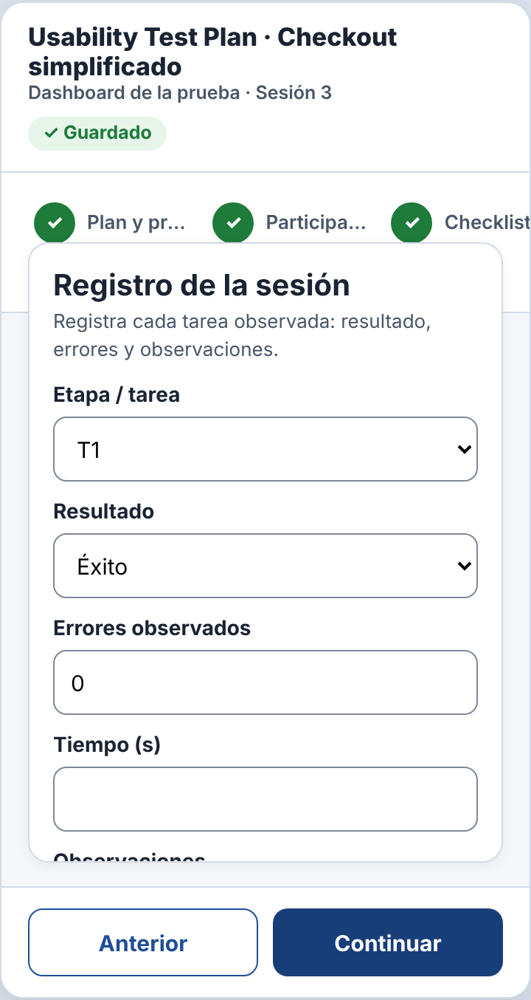
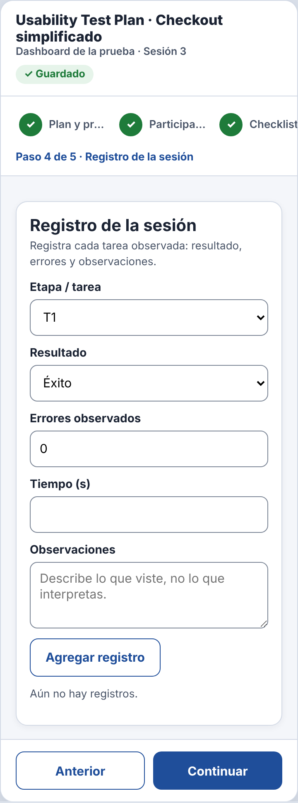
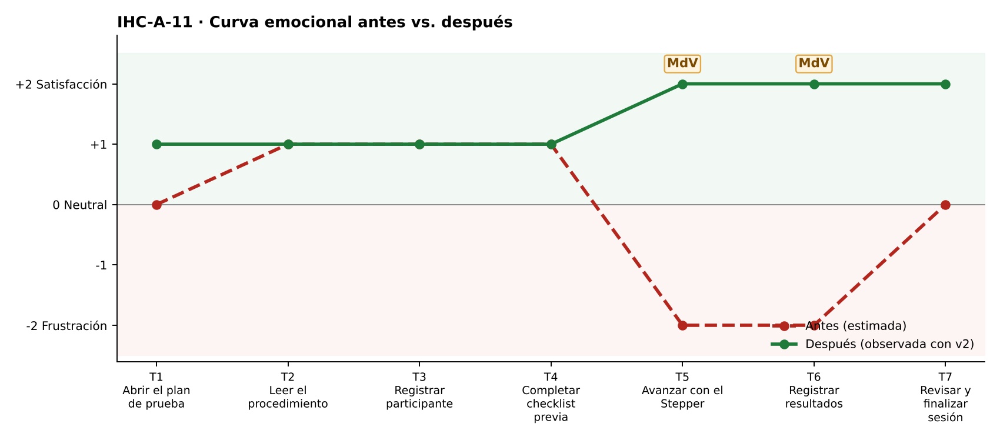

# Fase 4 · Prueba cognitiva y mejora — IHC-A-11 · Dashboard UX · Jerarquía en 360 px sin superposiciones

**Moderador:** Vinces Cueva Boris Yussef · **Observador:** González Álvarez Vladimir Humberto

| Elemento | Detalle |
|---|---|
| Participante | **PX-11** · Estudiante de otro equipo (Grupo 5) en una ventana de 360 px. No participó en el diseño. |
| Consigna (sin ayudas) | «Registrar etapa, errores y observaciones.» |
| Condición | Mantener jerarquía en un ancho de 360 px. |
| Prototipo | `prototipo/v1/` y luego `prototipo/v2/` (misma tarea). |
| Registro | Tiempo, errores, pausas > 3 s, resultado y cita textual. |

| Versión | Tiempo | Errores | Pausas | Resultado | Cita textual |
|---|---|---|---|---|---|
| v1 | 176 s | 3 | 2 (10 s buscando el Stepper; 8 s buscando Observaciones) | No encontró el campo Observaciones; registró sin observaciones | «La tarjeta tapa los pasos y no veo dónde escribir.» |
| v2 | 121 s | 1 | 1 (Tab saltó primero a los botones) | Vio todos los campos, pero el foco iba primero a los botones | «Ya se ve todo, pero el Tab va raro.» |

## Observaciones con v1
- La card subía sobre el Stepper.
- El campo Observaciones quedaba recortado.
- Tab visitaba Anterior/Continuar antes que los campos.

## Hallazgo corregido (Issue #11)
**Card UI superpuesta al Stepper que oculta campos (Issue #11).** Cambio en v2: Se quitan el margen negativo y la altura fija de `.card.step` (clase `bug`); los campos quedan visibles.

| Antes (v1) | Después (v2) |
|---|---|
|  |  |
| Card encima del Stepper y campos recortados (v1) | Sin superposición (v2) |

## Mejora demostrada frente a estimada
| Mejora | Tipo | Evidencia |
|---|---|---|
| Tiempo 176 s → 121 s | **Demostrada** | Misma tarea y participante, cronometrada. |
| Errores 3 → 1 | **Demostrada** | Registro de observación. |
| Resultado: «No encontró el campo Observaciones; registró sin observaciones» → «Vio todos los campos, pero el foco iba primero a los botones» | **Demostrada** | Observación y capturas. |
| Emoción en momentos de verdad: T5 −2 😟 → +2 😊; T6 −2 😟 → +2 😊 | Inferida de pausas y cita | `diagramas/curva-despues.png` |
| Generalización a otros usuarios | Estimada | Una sesión; requiere más participantes. |

