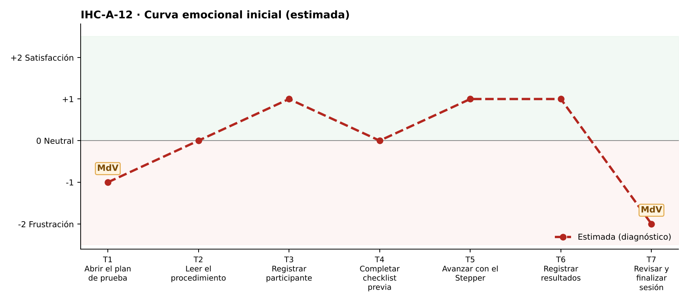

# Fase 1 · Diagnóstico emocional — IHC-A-12 · Dashboard UX · Retomar una prueba y cerrar sin éxito falso

**Responsable de la tarjeta:** Vinces Cueva Boris Yussef · **Revisor:** González Álvarez Vladimir Humberto · **Issue:** #12

## 1. Tarjeta
| Campo | Contenido |
|---|---|
| Persona usuaria | Investigadora que retoma una prueba interrumpida |
| Tarea crítica | Recuperar checklist y cerrar sesión |
| Restricción obligatoria | No perder los pasos previamente finalizados |
| Fallo adicional específico | El estado final aparece sin comprobar checklist obligatorio |
| Repositorio base | maribelsailema/HCI_2026_G1 (Usability Test Plan Dashboard: 7 touchpoints, 2 momentos de verdad, curva emocional, Card UI, Stepper y Grid) |
| Repositorio complementario | Sax300-cpu/HCI-2026-G2 (CaféU y su carpeta presentacion) |

## 2. Touchpoints
Siete touchpoints del recorrido de la tarea crítica sobre la interfaz de referencia. En esta fase las emociones son **estimadas**; las observadas están en `pruebas/sesion.md`.

| N.º | Touchpoint | Qué ocurre | Emoción estimada | Tipo | Momento de verdad |
|---|---|---|---|---|---|
| T1 | Abrir el plan de prueba | Reabre el plan tras una interrupción. | −1 | Estimado | **Sí** |
| T2 | Leer el procedimiento | Lee el aviso de prueba retomada. | 0 😐 | Estimado | — |
| T3 | Registrar participante | Verifica el código. | +1 | Estimado | — |
| T4 | Completar checklist previa | Recupera la checklist. | 0 😐 | Estimado | — |
| T5 | Avanzar con el Stepper | Avanza. | +1 | Estimado | — |
| T6 | Registrar resultados | Registra resultados. | +1 | Estimado | — |
| T7 | Revisar y finalizar sesión | Finaliza. | −2 😟 | Estimado | **Sí** |

## 3. Momentos de verdad
1. **T1 · Abrir el plan de prueba.** «Abrir el plan»: si se pierde lo hecho, la prueba empieza de cero.
2. **T7 · Revisar y finalizar sesión.** «Revisar y finalizar»: aparece «Sesión finalizada» aunque falten obligatorios.

## 4. Curva emocional inicial

## 5. Fallos priorizados
Prioridad = severidad de Nielsen × frecuencia esperada.

| N.º | Fallo | Heurística de Nielsen | Gestalt / carga cognitiva | Severidad | Frecuencia | Prioridad | Decisión | Seguimiento |
|---|---|---|---|---|---|---|---|---|
| 1 | El estado final aparece sin comprobar la checklist obligatoria | N1 (estado falso); N5 | — | 4 · Catastrófico | Alta | P1 | Bloquear el cierre si faltan obligatorios (v2). | Issue #12 |
| 2 | Al retomar no se sabe qué pasos ya se finalizaron | N1; N6 | Carga cognitiva: recordar dónde quedó | 3 · Grave | Media | P2 | Aviso «Retomaste una prueba interrumpida» con los pasos recuperados. | Tarea de la issue #12 |
| 3 | El éxito no muestra evidencia comprobable | N1; N9 | — | 3 · Grave | Media | P3 | Resumen con conteos en la confirmación. | Tarea de la issue #12 |

## 6. Estimación frente a observación
| Afirmación | Tipo | Cómo se comprueba |
|---|---|---|
| «El estado final aparece sin comprobar la checklist obligatoria» afecta la tarea crítica. | Estimación | Prueba cognitiva con v1 (tiempo, errores, pausas, cita). |
| Los momentos de verdad son T1 y T7. | Estimación | Pausas y comentarios de la prueba. |
| La curva mejora tras la corrección. | Estimación | Misma tarea con v2 (`curva-despues.png`). |

## 7. Principio del repositorio complementario
Rama «confirmar o editar» de CaféU: revisar con enlaces «Editar» antes de confirmar.
