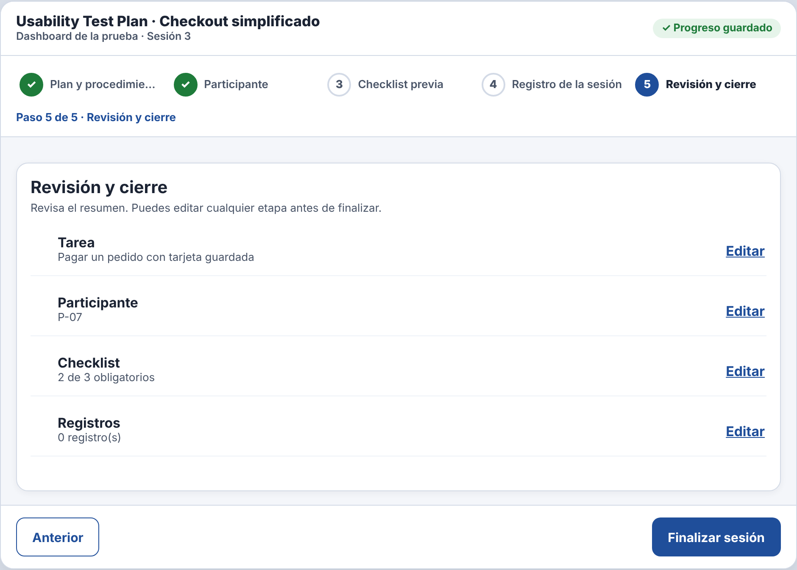
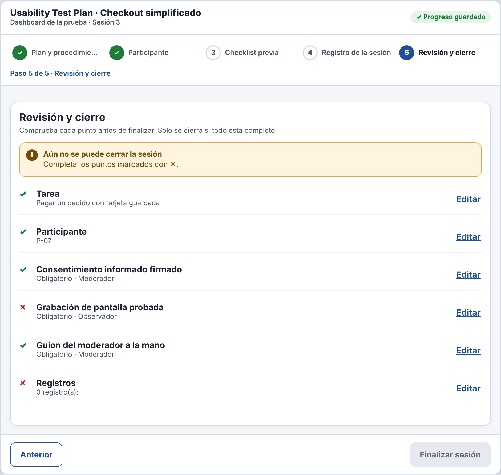

# Incidencia sorpresa — IHC-A-12 · Dashboard UX · Retomar una prueba y cerrar sin éxito falso

## Finalización prematura
| Campo | Detalle |
|---|---|
| Evento imprevisto | El sistema marca finalizada una sesión aunque falta un requisito del checklist. |
| Cambio obligatorio | Impedir finalización falsa, explicar elemento pendiente y permitir completarlo sin borrar datos. |
| Evidencias pedidas | Flujo actualizado, tres estados, test y commit. |
| Responsable / revisor | Vinces Cueva Boris Yussef / González Álvarez Vladimir Humberto |
| Issue | «IHC-A-12 · Incidencia: Finalización prematura» (hora del anuncio y SHA del commit registrados en la issue y en el PR) |

## Respuesta
| Evidencia | Dónde está |
|---|---|
| Requisito nuevo **RF-07** | Revisión previa con ✓/✕ por cada obligatorio, tarea, código y registros; «Finalizar» solo habilitado si todo está ✓ y el éxito incluye un resumen comprobable. — `docs/requisitos.md`, `docs/trazabilidad.md` |
| Flujo / wireframe actualizados | `diagramas/user-flow.png` (nodos en naranja) y `wireframes/wf-05-incidencia.png` |
| Cambio visible en el prototipo | `step4()` muestra la revisión previa ✓/✕ por punto; «Finalizar» se deshabilita (`aria-describedby`) mientras haya ✕; `done()` muestra un resumen comprobable con conteos. — `prototipo/v2/index.html` |
| Prueba funcional | La revisión previa mostró ✕ en «Grabación»; corrigió y finalizó con resumen (96 s, 0 errores). Cita: «Veo todo lo que falta antes de cerrar.» — `pruebas/sesion.md` |
| Antes / después | `evidencias/incidencia/` |

| Commit y revisión | Rama de incidencias de Boris, commit posterior al anuncio, PR revisado por Vladimir |
| Defensa | ¿Cómo muestra el momento de verdad y comprueba el estado final? — `docs/defensa.md` |

## Verificación (rúbrica de la incidencia, 0,25)
| Criterio | Cumplimiento |
|---|---|
| Funcionamiento comprobable (0,08) | Con un obligatorio pendiente, la revisión muestra ✕ y «Finalizar» queda deshabilitado. |
| Requisito, flujo o wireframe actualizado (0,05) | RF-07, user flow y `wf-05-incidencia.png` |
| Prueba y evidencia antes/después (0,05) | `pruebas/sesion.md` y `evidencias/incidencia/` |
| Commit posterior y revisión de compañero (0,04) | PR de incidencias revisado por González Álvarez Vladimir Humberto |
| Defensa individual (0,03) | `docs/defensa.md` |

| Antes (v2) | Después (v2 con la incidencia) |
|---|---|
|  |  |
