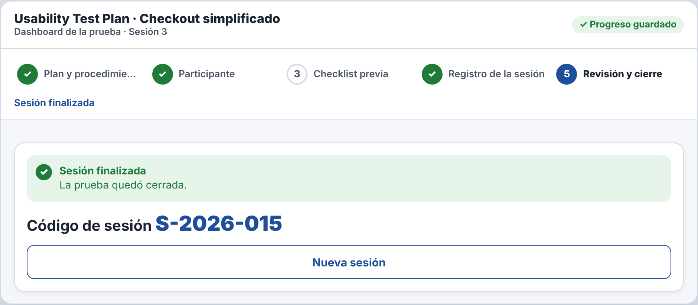
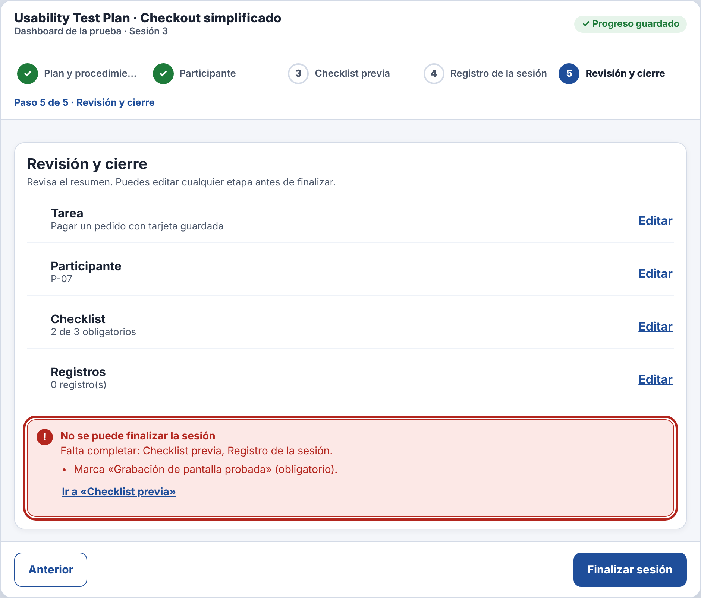
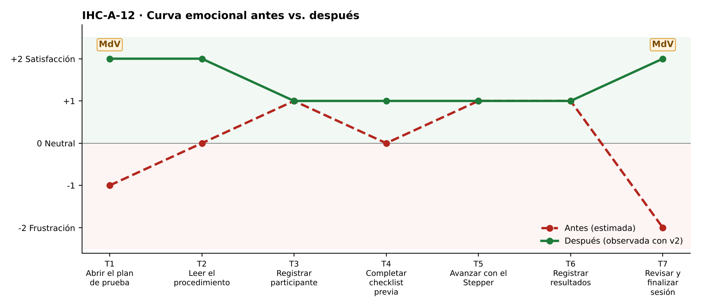

# Fase 4 · Prueba cognitiva y mejora — IHC-A-12 · Dashboard UX · Retomar una prueba y cerrar sin éxito falso

**Moderador:** Vinces Cueva Boris Yussef · **Observador:** González Álvarez Vladimir Humberto

| Elemento | Detalle |
|---|---|
| Participante | **PX-12** · Estudiante de otro equipo (Grupo 5); el moderador interrumpió la sesión en el paso 3. No participó en el diseño. |
| Consigna (sin ayudas) | «Recuperar checklist y cerrar sesión.» |
| Condición | No perder los pasos previamente finalizados. |
| Prototipo | `prototipo/v1/` y luego `prototipo/v2/` (misma tarea). |
| Registro | Tiempo, errores, pausas > 3 s, resultado y cita textual. |

| Versión | Tiempo | Errores | Pausas | Resultado | Cita textual |
|---|---|---|---|---|---|
| v1 | 118 s | 1 | 1 (7 s al retomar) | Finalizó con un obligatorio sin marcar y la app mostró «Sesión finalizada» | «Dijo finalizada, pero no marqué la grabación.» |
| v2 | 104 s | 0 | 1 (lectura del error) | El cierre se bloqueó; marcó el pendiente y finalizó | «Me frenó a tiempo.» |

## Observaciones con v1
- Al reabrir se recuperaron los datos.
- No marcó «Grabación de pantalla probada».
- Pulsó Finalizar y apareció «Sesión finalizada».

## Hallazgo corregido (Issue #12)
**Estado final sin comprobar la checklist obligatoria (Issue #12).** Cambio en v2: `finish()` revisa `allOk()` y, si falta algo, muestra el error con enlace al paso pendiente.

| Antes (v1) | Después (v2) |
|---|---|
|  |  |
| «Sesión finalizada» con checklist incompleta (v1) | Cierre bloqueado con error (v2) |

## Mejora demostrada frente a estimada
| Mejora | Tipo | Evidencia |
|---|---|---|
| Tiempo 118 s → 104 s | **Demostrada** | Misma tarea y participante, cronometrada. |
| Errores 1 → 0 | **Demostrada** | Registro de observación. |
| Resultado: «Finalizó con un obligatorio sin marcar y la app mostró «Sesión finalizada»» → «El cierre se bloqueó; marcó el pendiente y finalizó» | **Demostrada** | Observación y capturas. |
| Emoción en momentos de verdad: T1 −1 → +2 😊; T7 −2 😟 → +2 😊 | Inferida de pausas y cita | `diagramas/curva-despues.png` |
| Generalización a otros usuarios | Estimada | Una sesión; requiere más participantes. |

